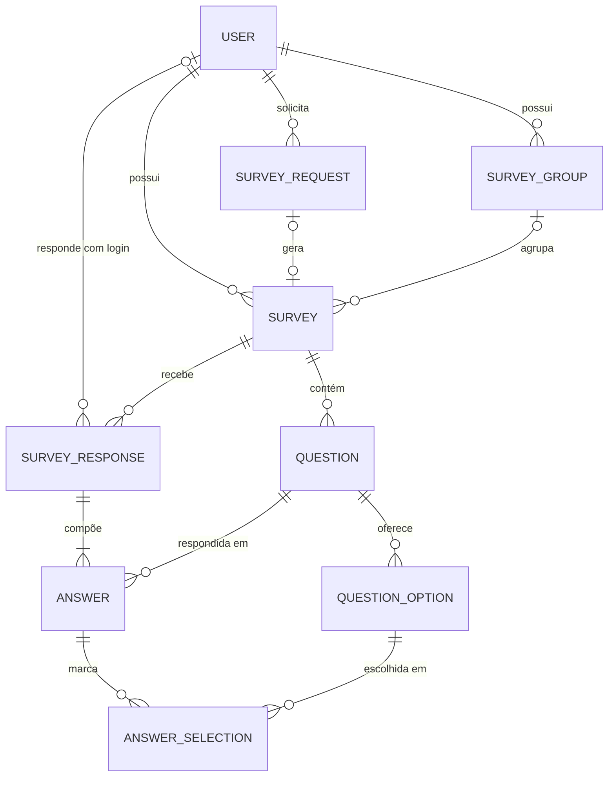

# Poll — Especificação de implementação

Referência de implementação do Criador de Enquetes (Projeto 07 do Portfólio Boost Program). Foi gerada a partir da especificação técnica completa do projeto, já com as 16 decisões de 19/10/2026 aplicadas. As regras de trabalho do Claude Code ficam no `CLAUDE.md`; aqui fica **o que** construir.

**Convenções**

- **Administrador** é o único usuário com papel `ADMIN`: o e-mail configurado em `ADMIN_EMAIL`.
- **[PROPOSTA]** marca um detalhe técnico definido nesta especificação, que não veio do PDF nem das decisões. Pode ser ajustado sem reabrir nenhuma decisão.
- **[A DEFINIR]** marca algo que ainda depende do Marcos. Não implemente antes da confirmação.
- IDs: `D` decisão · `RF` requisito funcional · `RN` regra de negócio · `T` tela · `US` história · `CT` caso de teste · `F` fase.

**Pendências abertas:** nenhuma. O conteúdo das pesquisas 2 e 3 do seed (D-12) foi aprovado em 20/10/2026.

---

## 1. Visão geral

### Objetivo

App web full-stack em que o administrador monta pesquisas de opinião sem escrever código, qualquer pessoa responde por um link e as respostas viram números, gráficos, comentários e um painel de tendências por grupo de pesquisas.

A pergunta de produto por trás do sistema: **que ferramentas a comunidade JavaScript usa, e onde há uma lacuna para um produto novo**. O projeto também precisa demonstrar, para quem avalia o portfólio, Next.js de ponta a ponta, modelagem relacional com Prisma, deploy serverless, gerenciamento de estado e formulários dinâmicos.

### Público

| Quem                    | O que faz no sistema                                                    |
| ----------------------- | ----------------------------------------------------------------------- |
| Respondentes            | Comunidade JavaScript e qualquer pessoa com o link; respondem sem conta |
| Usuários com conta      | Respondem identificados e pedem pesquisas novas ao administrador        |
| Administrador           | Marcos: cria, publica, gerencia e analisa as pesquisas                  |
| Visitantes do portfólio | Veem a página inicial e os resultados públicos                          |

### Tema inicial

Três pesquisas semeadas (conteúdo na seção 3, D-12), em dois grupos:

- Grupo **Ecossistema JavaScript**: "Ferramentas JavaScript favoritas" (Nível 1) e "Como você trabalha com JavaScript".
- Grupo **Entretenimento**: "Entretenimento favorito".

### Entregas por nível do PDF

| Nível | O que entrega                                                                                        | Release        |
| ----- | ---------------------------------------------------------------------------------------------------- | -------------- |
| 1     | Pesquisa respondível sobre ferramentas JS, respostas gravadas no banco e painel de resultados        | `v0.1.0` (MVP) |
| 2     | Construtor de pesquisas sem código, gerenciamento (listar, editar, publicar, excluir) e solicitações | `v0.2.0`       |
| 3     | Grupos de pesquisas e painel de tendências                                                           | `v0.3.0`       |

### Arquitetura em uma frase

Um único app Next.js na Vercel, com telas, API e regras no mesmo repositório; PostgreSQL no Prisma Postgres acessado via Prisma; Supabase Auth só para login; Jotai e React Hook Form só no navegador. O banco é a única fonte de verdade.

### Módulos

| Módulo                   | Requisitos    |
| ------------------------ | ------------- |
| M1 — Responder pesquisa  | RF-01 a RF-04 |
| M2 — Construtor          | RF-05 a RF-07 |
| M3 — Gerenciamento       | RF-08 a RF-11 |
| M4 — Resultados          | RF-12 a RF-15 |
| M5 — Grupos e tendências | RF-16, RF-17  |
| M6 — Acesso              | RF-18         |
| M7 — Conteúdo e vitrine  | RF-19, RF-20  |
| M8 — Solicitações        | RF-21, RF-22  |

### Fora do escopo

Nada disto entra sem pedido explícito:

- Lógica condicional entre perguntas (pular ou mostrar perguntas conforme a resposta).
- Upload de arquivos ou imagens.
- E-mails de qualquer tipo: notificações, convites, lembretes, aviso de mudança de status de solicitação.
- Múltiplos idiomas: a interface é só em pt-BR.
- Pagamentos, planos ou limites por conta.
- Edição simultânea da mesma pesquisa por várias pessoas.
- App mobile nativo; o app web responsivo cobre o celular.
- Restaurar pesquisa excluída (D-08) e abrir ou encerrar pesquisa automaticamente (D-09).
- Painel de tendências público (D-10) e opção "Outro, qual?" (D-04).

### Metas de produto

| Meta                                            | Alvo                                            |
| ----------------------------------------------- | ----------------------------------------------- |
| Responder a pesquisa do Nível 1 no celular      | Menos de 2 minutos, sem erro de layout a 360 px |
| Criar uma pesquisa de 3 perguntas no construtor | Menos de 3 minutos, sem tocar em código         |
| Respostas perdidas após envio confirmado        | Zero                                            |
| Resultado refletir uma resposta nova            | No próximo carregamento do painel               |

---

## 2. Perfis e permissões

| Perfil              | Quem é                                      | Como é identificado                                                   |
| ------------------- | ------------------------------------------- | --------------------------------------------------------------------- |
| Respondente anônimo | Qualquer pessoa com o link                  | Cookie de respondente (RN-14)                                         |
| Usuário com conta   | Entrou pelo Supabase Auth, com papel `USER` | Sessão do Supabase + `User.role = USER`                               |
| Administrador       | Único com papel `ADMIN`                     | Sessão do Supabase + `User.role = ADMIN`, definido pelo `ADMIN_EMAIL` |

| Funcionalidade                                                          | Respondente anônimo | Usuário com conta | Administrador               |
| ----------------------------------------------------------------------- | ------------------- | ----------------- | --------------------------- |
| Ver página inicial (RF-20)                                              | Sim                 | Sim               | Sim                         |
| Responder pesquisa publicada (RF-01, RF-03)                             | Sim, anônimo        | Sim, identificado | Sim                         |
| Ver resultados públicos: números, gráficos e comentários (RF-12, RF-14) | Sim                 | Sim               | Sim, inclusive de rascunhos |
| Ver tabela de respostas individuais e baixar CSV (RF-13, RF-15)         | Não                 | Não               | Sim                         |
| Solicitar pesquisa e ver as próprias solicitações (RF-21)               | Não (pede login)    | Sim               | Sim                         |
| Atender solicitações (RF-22)                                            | Não                 | Não               | Sim                         |
| Criar, editar, publicar, encerrar e excluir pesquisa (RF-05 a RF-11)    | Não                 | Não               | Sim                         |
| Gerenciar grupos (RF-16)                                                | Não                 | Não               | Sim                         |
| Ver painel de tendências (RF-17)                                        | Não                 | Não               | Sim                         |
| Rodar o seed (RF-19)                                                    | Não                 | Não               | Só pela linha de comando    |

Regras de acesso:

- Rota de gestão sem sessão → **401**. Com sessão, mas sem papel `ADMIN` → **404**, nunca 403, para não confirmar que a rota existe.
- O papel vem sempre do banco (`User.role`), que espelha o `ADMIN_EMAIL`. Nunca de um dado enviado pelo navegador.
- O callback de login cria o `User` no primeiro acesso e reavalia o papel a cada login, para que trocar o `ADMIN_EMAIL` tenha efeito [PROPOSTA].
- A checagem de papel acontece no servidor, em toda rota, página e Server Action de gestão. O `proxy.ts` ajuda, mas não substitui essa checagem.

---

## 3. Decisões

Todas tomadas em 19/10/2026. Não reabrir sem pedido.

| ID   | Decisão                                            | O que significa no código                                                                                                                                                                                     |
| ---- | -------------------------------------------------- | ------------------------------------------------------------------------------------------------------------------------------------------------------------------------------------------------------------- |
| D-01 | Login pelo Supabase Auth, usado só para login      | GitHub e link por e-mail. `User` local espelha o usuário do Supabase (mesmo id). Nenhum dado de domínio no Supabase                                                                                           |
| D-02 | Respondente anônimo por padrão, com login opcional | Envio aceita sessão ou não. Com sessão, grava `SurveyResponse.userId`                                                                                                                                         |
| D-03 | Banco no Prisma Postgres                           | URL com pool para o app, URL direta para migrações, banco separado para previews. Cada consulta conta como operação: agregar em poucas queries                                                                |
| D-04 | Quatro tipos de pergunta                           | `SINGLE_CHOICE`, `MULTIPLE_CHOICE`, `SHORT_TEXT`, `LONG_TEXT`. Sim/não e escala são escolha única com valores numéricos. Sem "Outro, qual?"                                                                   |
| D-05 | Controle de respostas duplicadas                   | Um envio por cookie (sem login) ou por conta (com login), limite por IP e chave de idempotência (RN-14)                                                                                                       |
| D-06 | Edição com respostas em modo restrito              | RN-11                                                                                                                                                                                                         |
| D-07 | Grupo explícito; três métricas de tendência        | 0 ou 1 grupo por pesquisa. Tendência = participação por período, opções mais escolhidas e evolução do percentual de uma opção                                                                                 |
| D-08 | Exclusão lógica, sem restaurar                     | `Survey.deletedAt`; link público vira 404                                                                                                                                                                     |
| D-09 | Abrir e encerrar só manualmente                    | Sem datas agendadas nem limite de respostas                                                                                                                                                                   |
| D-10 | Resultados públicos                                | Números, gráficos e comentários abertos para pesquisa publicada ou encerrada. Tabela individual e CSV só do administrador. Painel de tendências restrito ao administrador. Nunca expor quem respondeu (RN-23) |
| D-11 | Download em CSV                                    | Separador `;`, UTF-8 com BOM, para abrir direto no Excel em pt-BR                                                                                                                                             |
| D-12 | Perguntas das pesquisas iniciais                   | Rascunho aprovado; detalhado abaixo                                                                                                                                                                           |
| D-13 | Só o administrador cria pesquisas                  | Usuários com conta solicitam e ele cria (RF-21, RF-22). Sem limite por criador, porque só existe um                                                                                                           |
| D-14 | Comentário do Nível 1                              | Uma pergunta `LONG_TEXT` opcional no fim da pesquisa, como a Questão 3 do wireframe                                                                                                                           |
| D-15 | Gráficos com Chart.js                              | Via `react-chartjs-2`, carregado só no navegador                                                                                                                                                              |
| D-16 | Privacidade                                        | Anônimo por padrão; aviso no formulário de que comentários ficam públicos e de que não se deve escrever dados pessoais; página de privacidade simples (T14)                                                   |

### D-12 — Conteúdo do seed

Regras gerais do seed:

- Todas as pesquisas são criadas com status `PUBLISHED` e `isListed = true` [PROPOSTA], pertencendo ao administrador.
- O slug segue a RN-20 (gerado do título).
- Perguntas de escolha são obrigatórias; perguntas de texto são opcionais (RN-08).
- Os enunciados abaixo podem ter o texto ajustado. Tipos, opções e valores são os aprovados.

**Pesquisa 1 — "Ferramentas JavaScript favoritas"** · grupo Ecossistema JavaScript · Nível 1 · **completa**

| #   | Enunciado                                             | Tipo              | Obrigatória | Opções (valor numérico)                                          |
| --- | ----------------------------------------------------- | ----------------- | ----------- | ---------------------------------------------------------------- |
| 1   | Qual framework de interface você mais usa?            | `SINGLE_CHOICE`   | Sim         | React · Vue · Angular · Svelte · Solid · Nenhum                  |
| 2   | Quais ferramentas de build você usa?                  | `MULTIPLE_CHOICE` | Sim         | Vite · webpack · Turbopack · esbuild · Rollup · Nenhuma          |
| 3   | Quais ferramentas de teste você usa?                  | `MULTIPLE_CHOICE` | Sim         | Vitest · Jest · Playwright · Cypress · Testing Library · Nenhuma |
| 4   | Qual é o seu runtime principal?                       | `SINGLE_CHOICE`   | Sim         | Node.js · Bun · Deno                                             |
| 5   | Qual é a sua satisfação com o ecossistema JavaScript? | `SINGLE_CHOICE`   | Sim         | 1 (1) · 2 (2) · 3 (3) · 4 (4) · 5 (5)                            |
| 6   | Que ferramenta falta no seu dia a dia?                | `LONG_TEXT`       | Não         | —                                                                |

**Pesquisa 2 — "Como você trabalha com JavaScript"** · grupo Ecossistema JavaScript · **aprovada em 20/10/2026**

| #   | Enunciado                                         | Tipo                                    | Opções (valor numérico)                                                                                 |
| --- | ------------------------------------------------- | --------------------------------------- | ------------------------------------------------------------------------------------------------------- |
| 1   | Em que área você atua?                            | `SINGLE_CHOICE` | Front-end · Back-end · Full-stack · Mobile · Dados                                                      |
| 2   | Qual é o tamanho da empresa em que você trabalha? | `SINGLE_CHOICE` | Só eu · 2–10 · 11–50 · 51–200 · 201–1.000 · Mais de 1.000                       |
| 3   | Há quantos anos você trabalha com JavaScript?     | `SINGLE_CHOICE` com valores             | Menos de 1 (0,5) · 1–2 (1,5) · 3–5 (4) · 6–10 (8) · Mais de 10 (12)             |
| 4   | Qual é o seu tipo de projeto principal?           | `SINGLE_CHOICE` | Produto da empresa · Agência ou consultoria · Freelance · Open source · Estudos |

**Pesquisa 3 — "Entretenimento favorito"** · grupo Entretenimento · **aprovada em 20/10/2026**

| #   | Enunciado                                              | Tipo                                      | Opções (valor numérico)                                                                                                 |
| --- | ------------------------------------------------------ | ----------------------------------------- | ----------------------------------------------------------------------------------------------------------------------- |
| 1   | Qual é o seu formato de entretenimento preferido?      | `SINGLE_CHOICE`   | Séries · Filmes · Games · Podcasts · Livros                                                                             |
| 2   | Onde você costuma consumir entretenimento?             | `MULTIPLE_CHOICE` | Streaming de vídeo · Cinema · Console ou PC · Celular · Livro físico ou e-reader · App de áudio |
| 3   | Quantas horas por semana você dedica a entretenimento? | `SINGLE_CHOICE` com valores               | Menos de 2 (1) · 2–5 (3,5) · 6–10 (8) · 11–20 (15) · Mais de 20 (25)                            |

As sugestões das pesquisas 2 e 3 foram aprovadas em 20/10/2026; o seed cria os dois grupos e as três pesquisas.

---

## 4. Requisitos funcionais

Cada requisito traz a fase em que é implementado. Critérios de aceite numerados são referenciados nas histórias (seção 9) como `RF-xx (n)`.

### RF-01 — Exibir pesquisa publicada · F4

- **Objetivo:** mostrar o formulário com todas as perguntas da pesquisa, como no wireframe.
- **Entrada:** slug na URL (`/s/{slug}`).
- **Processamento:** buscar a pesquisa pelo slug, ignorando excluídas; carregar perguntas e opções sem `archivedAt`, ordenadas por `position`.
- **Saída:** título, descrição, perguntas na ordem e botão Salvar.
- **Regras:** RN-04, RN-13.
- **Permissões:** qualquer pessoa.
- **Critérios de aceite:**
  1. Uma pesquisa publicada exibe todas as perguntas ativas na ordem configurada.
  2. Uma pesquisa encerrada exibe "Esta pesquisa não aceita mais respostas" e nenhum botão de envio.
  3. Rascunho, pesquisa excluída ou slug inexistente retorna a página 404.
  4. A tela é utilizável sem rolagem horizontal a 360 px de largura.

### RF-02 — Componentes por tipo de pergunta · F4

- **Objetivo:** um componente React por tipo, reutilizado no formulário público e no preview do construtor.
- **Entrada:** definição da pergunta (tipo, enunciado, ajuda, opções, obrigatoriedade, limites de seleção).
- **Processamento:** um `QuestionRenderer` escolhe o componente pelo tipo.
- **Saída:**
  - `SINGLE_CHOICE` — botões de rádio.
  - `MULTIPLE_CHOICE` — caixas de seleção, com mínimo e máximo opcionais.
  - `SHORT_TEXT` — campo de uma linha, até 200 caracteres.
  - `LONG_TEXT` — área de texto, até 2.000 caracteres.
- **Regras:** RN-05 a RN-08, com o mesmo schema Zod no cliente e no servidor.
- **Critérios de aceite:**
  1. Cada tipo renderiza o controle correto, com rótulo associado e navegável por teclado.
  2. O preview do construtor e o formulário real usam o mesmo componente.
  3. Os campos de texto mostram um contador de caracteres.

### RF-03 — Enviar respostas · F4 (critério 7 na F7)

- **Objetivo:** o participante envia todas as respostas de uma vez pelo botão Salvar.
- **Entrada:** `idempotencyKey` e lista `{ questionId, optionIds?, text? }`; sessão do Supabase, se houver.
- **Processamento:** validar no cliente (React Hook Form + Zod); revalidar no servidor contra a estrutura atual da pesquisa; checar status; checar duplicidade pela conta (com sessão) ou pelo cookie (sem sessão); gravar (RF-04).
- **Saída:** página de agradecimento (T03); a API devolve 201 com o id da resposta.
- **Regras:** RN-04 a RN-10, RN-14.
- **Permissões:** respondente anônimo ou com conta.
- **Critérios de aceite:**
  1. Um envio válido grava uma resposta completa, com todas as perguntas respondidas.
  2. Uma obrigatória vazia bloqueia o envio e destaca o campo com a mensagem.
  3. Uma opção de outra pergunta é recusada com 422.
  4. Se a pesquisa foi encerrada entre abrir e enviar, o envio recebe 409 e uma mensagem clara.
  5. Dois cliques seguidos geram uma única resposta.
  6. As respostas digitadas sobrevivem a um recarregamento da página até o envio (Jotai `atomWithStorage`).
  7. Com login, a mesma conta não consegue responder duas vezes à mesma pesquisa, nem de outro navegador.

### RF-04 — Gravar respostas no banco · F4

- **Objetivo:** guardar respostas de forma durável e consultável.
- **Entrada:** resposta já validada pelo RF-03.
- **Processamento:** **uma única transação** grava a `SurveyResponse`, uma `Answer` por pergunta respondida e uma `AnswerSelection` por opção marcada.
- **Regras:** RN-09, RN-10.
- **Permissões:** só o servidor escreve. Não existe rota para editar resposta enviada.
- **Critérios de aceite:**
  1. A resposta continua lá após recarregar a página e após um novo deploy.
  2. Uma falha no meio da gravação não deixa resposta parcial.
  3. As contagens do painel batem com uma contagem direta no banco.

### RF-05 — Criar pesquisa sem código · F6

- **Objetivo:** o administrador monta uma pesquisa numa interface visual (T06).
- **Entrada:** título, descrição opcional, grupo opcional, vitrine (`isListed`), lista de perguntas.
- **Processamento:** formulário em React Hook Form com listas aninhadas (`useFieldArray` para perguntas e para opções); preview ao vivo com os componentes do RF-02; salvar como rascunho; slug gerado do título (RN-20).
- **Saída:** pesquisa em `DRAFT` e redirecionamento para a edição.
- **Regras:** RN-01 a RN-03, RN-12.
- **Validações:** título de 3 a 120 caracteres; descrição até 1.000; demais validações do RF-06.
- **Permissões:** administrador.
- **Critérios de aceite:**
  1. Dá para criar uma pesquisa com 3 perguntas de tipos diferentes sem tocar em código.
  2. O preview mostra exatamente o que o participante verá.
  3. Cada erro aparece junto do campo que o causou.
  4. Um rascunho incompleto pode ser salvo; só a publicação exige a pesquisa completa.

### RF-06 — Configurar perguntas · F6

- **Objetivo:** definir cada pergunta da pesquisa.
- **Entrada:** tipo, enunciado, texto de ajuda opcional, obrigatória, opções (rótulo e valor opcional), mínimo e máximo de seleções.
- **Processamento:** adicionar, remover, duplicar e reordenar perguntas e opções com botões subir e descer. Arrastar e soltar fica fora.
- **Regras:** RN-02, RN-03, RN-06, RN-11, RN-13.
- **Validações:** enunciado de 3 a 300 caracteres; ajuda até 500; opção de 1 a 120; mínimo ≤ máximo ≤ número de opções; até 50 perguntas e 30 opções por pergunta.
- **Permissões:** administrador.
- **Critérios de aceite:**
  1. Reordenar atualiza o preview na hora.
  2. Trocar uma pergunta de escolha para texto pede confirmação, porque descarta as opções.
  3. Limites incoerentes de seleção mostram erro e impedem salvar.

### RF-07 — Opções com valor numérico · F6

- **Objetivo:** coletar dados numéricos por opções numéricas (ex.: faixas de anos de experiência).
- **Entrada:** campo opcional `value` (decimal) em cada opção.
- **Processamento:** quando **todas** as opções ativas de uma pergunta têm valor, o painel calcula média e mediana.
- **Regras:** RN-16.
- **Validações:** número finito; vazio é permitido.
- **Permissões:** administrador.
- **Critérios de aceite:**
  1. Uma pergunta com valores em todas as opções mostra média e mediana no painel.
  2. Uma pergunta sem valores, ou com valores parciais, não mostra essas estatísticas.

### RF-08 — Listar pesquisas · F7

- **Objetivo:** o administrador vê e acessa todas as pesquisas (T05).
- **Entrada:** filtros por status, grupo e texto do título; página.
- **Processamento:** pesquisas não excluídas do administrador, ordenadas pela última alteração.
- **Saída:** título, status, grupo, número de respostas, data da última resposta e ações (editar, resultados, publicar, encerrar, reabrir, excluir, copiar link).
- **Regras:** RN-12.
- **Permissões:** administrador.
- **Critérios de aceite:**
  1. Sem pesquisas, a tela mostra um convite para criar a primeira.
  2. Os filtros funcionam combinados.
  3. A contagem de respostas de cada linha bate com o painel da pesquisa.

### RF-09 — Editar perguntas · F6

- **Objetivo:** alterar uma pesquisa existente.
- **Entrada:** a mesma estrutura do RF-05 (itens existentes levam `id`) e a `version` que foi aberta.
- **Processamento:** sem respostas, a edição é livre; com respostas, vale o modo restrito da RN-11; uma versão mais nova salva em outra aba gera conflito (RN-17).
- **Regras:** RN-11, RN-13, RN-17.
- **Permissões:** administrador.
- **Critérios de aceite:**
  1. Sem respostas, qualquer campo pode mudar.
  2. Com respostas, uma pergunta ou opção removida some do formulário público, mas seus resultados históricos continuam no painel.
  3. Com respostas, trocar o tipo de uma pergunta é bloqueado com uma explicação.
  4. Salvar sobre uma versão desatualizada retorna 409 e pede para recarregar.

### RF-10 — Excluir pesquisa · F7

- **Objetivo:** remover uma pesquisa que não é mais usada.
- **Entrada:** id da pesquisa e confirmação num diálogo que mostra quantas respostas serão perdidas.
- **Processamento:** exclusão lógica (`deletedAt`); o link público deixa de funcionar.
- **Regras:** RN-12, RN-19.
- **Permissões:** administrador.
- **Critérios de aceite:**
  1. O diálogo informa o número de respostas antes de confirmar.
  2. Depois de excluída, o link público e os resultados públicos retornam 404.
  3. Um usuário sem papel `ADMIN` não consegue excluí-la (a API responde 404).

### RF-11 — Publicar, encerrar e reabrir · F7

- **Objetivo:** controlar quando uma pesquisa aceita respostas.
- **Entrada:** ação `publish`, `close` ou `reopen`.
- **Processamento:** transição conforme RN-15; publicar revalida a pesquisa inteira (RN-01, RN-02), grava `publishedAt` e fixa o slug (RN-20); encerrar grava `closedAt`.
- **Saída:** novo status e link público copiável.
- **Regras:** RN-01, RN-02, RN-04, RN-15, RN-20.
- **Permissões:** administrador.
- **Critérios de aceite:**
  1. Publicar um rascunho inválido lista os erros e não muda o status.
  2. Após publicar, o link aparece com botão de copiar.
  3. Uma pesquisa encerrada recusa envios com 409.
  4. Reabrir volta a aceitar respostas no mesmo link.

### RF-12 — Painel de resultados · F5

- **Objetivo:** ver os resultados de uma pesquisa: as respostas de todas as perguntas e as estatísticas gerais.
- **Entrada:** slug (versão pública, T10) ou id (versão do administrador, T07); período opcional.
- **Processamento:** agregações feitas no banco, com contagens agrupadas, nunca carregando todas as respostas na memória:
  - gerais: total de respostas, data da primeira e da última, respostas por dia;
  - por pergunta de escolha: contagem e percentual por opção, quantos responderam a pergunta;
  - por pergunta numérica: média e mediana (RF-07);
  - por pergunta de texto: lista paginada das respostas.
- **Saída:** cartões de números gerais, um bloco por pergunta (gráfico e números) e os comentários.
- **Regras:** RN-16, RN-23.
- **Validações:** na versão pública, a pesquisa precisa estar publicada ou encerrada; período com início ≤ fim.
- **Permissões:** qualquer pessoa para pesquisa publicada ou encerrada; o administrador vê também rascunhos.
- **Critérios de aceite:**
  1. Os números batem com uma contagem manual sobre um conjunto de respostas de teste conhecido.
  2. Em múltipla escolha, o painel avisa que os percentuais podem somar mais de 100%.
  3. Sem respostas, o painel mostra um estado vazio com o link da pesquisa.
  4. Perguntas arquivadas aparecem marcadas como "removida", com seus dados históricos.
  5. A versão pública não mostra a tabela individual, o botão de download nem qualquer dado de quem respondeu.

### RF-13 — Tabela de respostas · F5

- **Objetivo:** ver as respostas individuais em tabela (aba de T07).
- **Entrada:** id da pesquisa, página e tamanho da página (máximo 100).
- **Processamento:** uma linha por resposta, da mais recente para a mais antiga; uma coluna por pergunta.
- **Regras:** RN-12, RN-23.
- **Permissões:** administrador.
- **Critérios de aceite:**
  1. A paginação é estável: uma resposta nova não duplica linhas entre páginas.
  2. Opções múltiplas aparecem unidas por "; ".
  3. Textos longos aparecem truncados, com opção de expandir.

### RF-14 — Gráficos de resultados · F5

- **Objetivo:** mostrar os dados de forma visual e interativa.
- **Entrada:** agregados do RF-12 e do RF-17.
- **Processamento:** Chart.js via `react-chartjs-2`: barras horizontais para opções, linha para respostas ao longo do tempo, tooltip com contagem e percentual.
- **Regras:** RN-16.
- **Permissões:** as mesmas do painel onde o gráfico aparece.
- **Critérios de aceite:**
  1. Os gráficos carregam só no navegador, sem erro de renderização no servidor.
  2. Cada gráfico mostra rótulos e números; a informação não depende só de cor.
  3. Cada gráfico tem uma tabela equivalente acessível para leitores de tela.

### RF-15 — Baixar resultados · F5

- **Objetivo:** levar os dados para fora do sistema por um botão em T07.
- **Entrada:** id da pesquisa e `format=csv`.
- **Processamento:** gerar no servidor um CSV com todas as respostas, uma linha por resposta e uma coluna por pergunta; UTF-8 com BOM e separador `;`.
- **Saída:** arquivo `pesquisa-{slug}-{AAAA-MM-DD}.csv`.
- **Regras:** RN-12, RN-18.
- **Permissões:** administrador.
- **Critérios de aceite:**
  1. O arquivo abre no Excel e no Google Sheets com acentos corretos.
  2. Contém todas as respostas, não só a página visível da tabela.
  3. Um texto que começa com `=`, `+`, `-` ou `@` é exportado neutralizado.

### RF-16 — Agrupar pesquisas · F8

- **Objetivo:** reunir pesquisas relacionadas, como "Ecossistema JavaScript" e "Entretenimento" (T08).
- **Entrada:** nome e descrição do grupo; pesquisas associadas (pelo seletor de grupo do construtor).
- **Processamento:** criar, renomear e excluir grupos; mover pesquisas entre grupos.
- **Regras:** RN-12, RN-21.
- **Validações:** nome de 2 a 80 caracteres, único; descrição até 500.
- **Permissões:** administrador.
- **Critérios de aceite:**
  1. Uma pesquisa pode ser movida para um grupo e para fora dele.
  2. Excluir um grupo não exclui suas pesquisas; elas ficam sem grupo.

### RF-17 — Painel de tendências · F8

- **Objetivo:** mostrar as tendências do grupo de pesquisas (Nível 3, T09).
- **Entrada:** grupo (ou todos), período e granularidade (`week` ou `month`).
- **Processamento:** três métricas (D-07):
  - **participação:** respostas por período em cada pesquisa do grupo;
  - **preferências:** opções mais escolhidas em cada pergunta;
  - **evolução:** percentual de uma opção ao longo do tempo (ex.: quem escolhe Vite como bundler, mês a mês).
- **Saída:** cartões de números, gráfico de linha e ranking por pergunta.
- **Regras:** RN-16.
- **Permissões:** administrador (D-10).
- **Critérios de aceite:**
  1. Mudar o período atualiza todos os blocos do painel.
  2. Um grupo sem respostas mostra estado vazio.
  3. Cada métrica traz uma explicação curta de como é calculada.

### RF-18 — Login · F3 (login do respondente na F7)

- **Objetivo:** só o administrador cria, gerencia e vê dados privados; quem responde pode entrar, se quiser, para responder identificado e solicitar pesquisas.
- **Entrada:** login pelo Supabase Auth, com GitHub ou link por e-mail.
- **Processamento:** o Supabase emite a sessão em cookie; o `proxy.ts` renova a sessão; o servidor valida a sessão com `supabase.auth.getClaims()` a cada requisição protegida (nunca confiando em `getSession()`); no primeiro login, o callback cria o `User` local com o mesmo id do Supabase; o e-mail igual a `ADMIN_EMAIL` recebe `ADMIN`.
- **Saída:** sessão ativa; o administrador acessa `/admin`; o usuário comum acessa `/requests`.
- **Regras:** RN-12, RN-14, RN-22.
- **Permissões:** qualquer pessoa pode criar conta; só o administrador gerencia (D-13).
- **Critérios de aceite:**
  1. Acessar `/admin` sem sessão redireciona para `/login`.
  2. Um usuário com conta, mas sem papel `ADMIN`, recebe 404 em `/admin` e na API de gestão.
  3. A API de gestão sem sessão responde 401.
  4. Com o Supabase fora do ar, páginas públicas, resultados públicos e envio anônimo continuam funcionando.

### RF-19 — Pesquisas iniciais · F2 (validado na F3)

- **Objetivo:** o sistema já nasce com a pesquisa do Nível 1 e os exemplos de tecnologia e entretenimento.
- **Entrada:** `npm run db:seed`.
- **Processamento:** achar o administrador pelo `ADMIN_EMAIL` (ele precisa ter entrado uma vez); criar os grupos e as pesquisas da seção 3 (D-12), publicadas; rodar de novo não duplica nada.
- **Regras:** RN-01, RN-02, RN-20.
- **Permissões:** só pela linha de comando.
- **Critérios de aceite:**
  1. A pesquisa "Ferramentas JavaScript favoritas" tem as 6 perguntas da seção 3, incluindo múltipla escolha e o comentário opcional no fim.
  2. Rodar o seed duas vezes deixa o banco no mesmo estado.
  3. Sem o administrador no banco, o seed para com uma mensagem clara e código de saída diferente de zero.

### RF-20 — Página inicial com pesquisas abertas · F7

- **Objetivo:** dar ao visitante um ponto de entrada além do link direto (T01).
- **Processamento:** listar pesquisas `PUBLISHED`, com `isListed = true` e não excluídas, da publicação mais recente para a mais antiga.
- **Saída:** cartões com título, descrição, número de perguntas, link para responder e link para os resultados.
- **Regras:** RN-04.
- **Permissões:** qualquer pessoa.
- **Critérios de aceite:**
  1. Só pesquisas publicadas e marcadas para a vitrine aparecem.
  2. Encerradas e rascunhos nunca aparecem.

### RF-21 — Solicitar pesquisa · F7

- **Objetivo:** quem quer uma pesquisa nova pede ao administrador, único que cria (T11, T12).
- **Entrada:** tema (5 a 120 caracteres), objetivo (obrigatório, até 1.000), sugestões de perguntas (opcional, até 4.000), público-alvo (opcional, até 200).
- **Processamento:** gravar a solicitação como `PENDING`, ligada à conta de quem pediu.
- **Saída:** confirmação e a solicitação em "Minhas solicitações", com status.
- **Regras:** RN-22.
- **Validações:** tamanhos acima; até 3 solicitações por usuário por dia.
- **Permissões:** usuário com conta.
- **Critérios de aceite:**
  1. A solicitação enviada aparece como "Pendente" em Minhas solicitações.
  2. A quarta solicitação no mesmo dia recebe 429.
  3. Sem login, o botão leva ao login e depois volta ao formulário.

### RF-22 — Atender solicitações · F7

- **Objetivo:** o administrador avalia os pedidos e cria as pesquisas aceitas (T13).
- **Entrada:** novo status, nota opcional ao solicitante (até 1.000), pesquisa criada.
- **Processamento:** fila por status; o botão "Criar pesquisa a partir desta" abre o construtor com tema e sugestões preenchidos; salvar o rascunho liga a pesquisa à solicitação e a move para `ACCEPTED`; publicar a pesquisa ligada a move para `DONE` (RN-22).
- **Regras:** RN-22.
- **Validações:** transição de status permitida; a pesquisa ligada pertence ao administrador e não atende outra solicitação.
- **Permissões:** administrador.
- **Critérios de aceite:**
  1. A fila filtra por status e mostra as pendentes mais antigas primeiro.
  2. Criar a partir da solicitação preenche o construtor.
  3. Uma solicitação concluída mostra ao solicitante o link da pesquisa.
  4. Uma solicitação recusada mostra a nota do administrador.

---

## 5. Regras de negócio

| ID    | Regra                                                                                                                                                                                                                                                                                                                                   | Onde aplicar                                                   | Fase    |
| ----- | --------------------------------------------------------------------------------------------------------------------------------------------------------------------------------------------------------------------------------------------------------------------------------------------------------------------------------------- | -------------------------------------------------------------- | ------- |
| RN-01 | Publicar exige título com pelo menos 3 caracteres úteis e pelo menos 1 pergunta ativa                                                                                                                                                                                                                                                   | Serviço de status, construtor, banco (CHECK do título)         | F6 / F7 |
| RN-02 | Perguntas de escolha exigem pelo menos 2 opções ativas para publicar                                                                                                                                                                                                                                                                    | Serviço de status, construtor                                  | F6 / F7 |
| RN-03 | Rótulos de opção são únicos dentro da pergunta, sem diferenciar maiúsculas nem espaços nas pontas; opções arquivadas não contam                                                                                                                                                                                                         | Schema Zod, banco (índice único parcial)                       | F2 / F6 |
| RN-04 | Só pesquisa `PUBLISHED` aceita respostas. `CLOSED` mostra aviso e a API responde 409 `SURVEY_CLOSED`. `DRAFT` ou excluída responde 404                                                                                                                                                                                                  | Página pública, serviço de respostas                           | F4      |
| RN-05 | Escolha única: no máximo 1 opção; exatamente 1 se obrigatória                                                                                                                                                                                                                                                                           | Schema compartilhado, serviço de respostas                     | F4      |
| RN-06 | Múltipla escolha: quantidade entre o mínimo e o máximo configurados; pelo menos 1 se obrigatória; cada opção no máximo uma vez                                                                                                                                                                                                          | Schema compartilhado, serviço, banco (PK de `AnswerSelection`) | F4      |
| RN-07 | Texto: espaços nas pontas removidos; curto até 200 caracteres, longo até 2.000; vazio conta como não respondida                                                                                                                                                                                                                         | Schema, serviço, banco (CHECK)                                 | F4      |
| RN-08 | Pergunta obrigatória precisa de resposta. Padrão ao criar: obrigatória para escolha, opcional para texto                                                                                                                                                                                                                                | Schema, construtor                                             | F4 / F6 |
| RN-09 | Resposta enviada é imutável: nem participante nem administrador a editam                                                                                                                                                                                                                                                                | API (não existe rota de edição)                                | F4      |
| RN-10 | Em cada envio, cada pergunta é respondida no máximo uma vez                                                                                                                                                                                                                                                                             | Serviço, banco (UNIQUE `responseId + questionId`)              | F2 / F4 |
| RN-11 | Pesquisa com respostas (modo restrito): corrigir textos, adicionar e reordenar pode; remover pergunta ou opção vira `archivedAt`; trocar tipo ou valor numérico → 422 `EDIT_NOT_ALLOWED`                                                                                                                                                | Serviço de edição, construtor                                  | F6      |
| RN-12 | Só o administrador cria e gerencia pesquisas e grupos. O papel vem do `ADMIN_EMAIL`, gravado em `User.role` e conferido no servidor. Todo registro guarda o dono e toda consulta de gestão filtra por ele                                                                                                                               | Helper `requireAdmin`, repositórios                            | F3      |
| RN-13 | Perguntas e opções aparecem em ordem crescente de `position`, sem buracos (0, 1, 2…) depois de salvar. A posição vem da ordem do array enviado                                                                                                                                                                                          | Serviço de edição, consultas                                   | F4 / F6 |
| RN-14 | Um envio por pesquisa: por conta, com sessão; por navegador, sem sessão (token em cookie, gravado só como hash). Cada envio leva uma `idempotencyKey`; repetir a mesma chave devolve 200 com a resposta já gravada                                                                                                                      | Serviço de respostas, banco (UNIQUE)                           | F4 / F7 |
| RN-15 | Ciclo de vida: `DRAFT` → `PUBLISHED` ↔ `CLOSED`; qualquer status → excluída. Com respostas, nunca volta a `DRAFT`. Transição inválida → 409 `INVALID_TRANSITION`                                                                                                                                                                        | Serviço de status                                              | F7      |
| RN-16 | Percentual da opção = vezes escolhida ÷ participantes que responderam a pergunta. Em múltipla escolha a soma pode passar de 100%. Média e mediana só quando todas as opções ativas têm valor                                                                                                                                            | Serviço de resultados                                          | F5      |
| RN-17 | Salvar com `version` diferente da atual → 409 `VERSION_CONFLICT`. Cada salvamento bem-sucedido incrementa `version`                                                                                                                                                                                                                     | Serviço de edição                                              | F6      |
| RN-18 | Exportação inclui todas as respostas e neutraliza células que começam com `=`, `+`, `-` ou `@` (prefixo `'`)                                                                                                                                                                                                                            | Gerador de CSV                                                 | F5      |
| RN-19 | Exclusão é lógica (`deletedAt`); a pesquisa sai das listas e o link público e os resultados públicos passam a 404                                                                                                                                                                                                                       | Serviço de pesquisas, todas as consultas                       | F7      |
| RN-20 | Slug gerado do título: minúsculas, sem acento, hífens, único (sufixo `-2`, `-3` em colisão). Fica fixo depois da primeira publicação                                                                                                                                                                                                    | Serviço de pesquisas, banco (UNIQUE)                           | F2 / F6 |
| RN-21 | Uma pesquisa pertence a nenhum ou a um grupo; excluir o grupo desvincula as pesquisas                                                                                                                                                                                                                                                   | Banco (FK com `SET NULL`)                                      | F2 / F8 |
| RN-22 | Solicitação: `PENDING` → `IN_REVIEW` (opcional) → `ACCEPTED` → `DONE`, ou `PENDING`/`IN_REVIEW` → `REJECTED` (com nota). Ligar uma pesquisa à solicitação a leva a `ACCEPTED`; publicar a pesquisa ligada a leva a `DONE` [PROPOSTA quanto às transições automáticas]. Só o administrador muda o status; cada usuário vê só as próprias | Serviço de solicitações                                        | F7      |
| RN-23 | Resultados de pesquisa publicada ou encerrada são públicos: números, gráficos e comentários. Nunca mostram id, e-mail, cookie ou qualquer dado de quem respondeu. Tabela individual e CSV só para o administrador                                                                                                                       | API pública de resultados, T10                                 | F5      |

---

## 6. Modelo de dados

Base da Fase 2. Respostas ficam normalizadas — uma linha por pergunta respondida e uma por opção marcada — para que o painel conte com `GROUP BY` em vez de ler JSON.

### 6.1 Nomes dos modelos

| Nome usado no pedido | Modelo Prisma     | Motivo                                                      |
| -------------------- | ----------------- | ----------------------------------------------------------- |
| User                 | `User`            | —                                                           |
| Survey               | `Survey`          | —                                                           |
| Question             | `Question`        | —                                                           |
| Option               | `QuestionOption`  | `Option` já é um construtor global do DOM                   |
| Response             | `SurveyResponse`  | `Response` já é um tipo global (fetch)                      |
| Answer               | `Answer`          | —                                                           |
| Group                | `SurveyGroup`     | Clareza no código                                           |
| SurveyRequest        | `SurveyRequest`   | —                                                           |
| —                    | `AnswerSelection` | Liga uma `Answer` às opções marcadas                        |
| —                    | `RateLimitBucket` | Contador do limite de envios quando não há Redis [PROPOSTA] |

### 6.2 Entidades

| Entidade          | Finalidade                                                                | Relacionamentos                                                                              | Integridade                                                                              |
| ----------------- | ------------------------------------------------------------------------- | -------------------------------------------------------------------------------------------- | ---------------------------------------------------------------------------------------- |
| `User`            | Espelho local do usuário do Supabase Auth: mesmo id, e-mail, nome e papel | Possui `Survey` e `SurveyGroup` (só o administrador); faz `SurveyResponse` e `SurveyRequest` | E-mail único; criado no primeiro login                                                   |
| `SurveyGroup`     | Grupo de pesquisas do Nível 3                                             | 1 dono → N grupos; 1 grupo → N pesquisas                                                     | Nome único por dono; excluir desvincula as pesquisas (RN-21)                             |
| `Survey`          | Pesquisa, com status, slug e versão                                       | Pertence ao administrador e a 0 ou 1 grupo; pode atender 1 solicitação                       | Slug único (RN-20); exclusão lógica (RN-19); versão para conflito (RN-17)                |
| `Question`        | Pergunta de uma pesquisa                                                  | 1 pesquisa → N perguntas                                                                     | Limites de seleção coerentes; arquivada em vez de apagada quando há respostas (RN-11)    |
| `QuestionOption`  | Opção de uma pergunta de escolha, com valor numérico opcional             | 1 pergunta → N opções                                                                        | Rótulo único entre opções ativas (RN-03)                                                 |
| `SurveyResponse`  | Um envio completo de um participante                                      | 1 pesquisa → N envios; 0 ou 1 usuário por envio                                              | Chave de idempotência única; um envio por cookie e um por conta em cada pesquisa (RN-14) |
| `Answer`          | Resposta a uma pergunta dentro de um envio                                | 1 envio → N respostas; 1 pergunta → N respostas                                              | Uma resposta por pergunta por envio (RN-10); texto não pode ser só espaços               |
| `AnswerSelection` | Opção marcada numa resposta de escolha                                    | Liga `Answer` a `QuestionOption`                                                             | Chave composta impede marcar a mesma opção duas vezes (RN-06)                            |
| `SurveyRequest`   | Pedido de pesquisa feito por um usuário                                   | 1 usuário → N pedidos; 0 ou 1 pesquisa gerada                                                | Status conforme RN-22; uma pesquisa atende no máximo um pedido                           |
| `RateLimitBucket` | Janela de contagem do limite de envios                                    | —                                                                                            | Chave única por escopo e IP em hash [PROPOSTA]                                           |

### 6.3 Valores permitidos

| Enum            | Valores                                                       |
| --------------- | ------------------------------------------------------------- |
| `SurveyStatus`  | `DRAFT`, `PUBLISHED`, `CLOSED`                                |
| `QuestionType`  | `SINGLE_CHOICE`, `MULTIPLE_CHOICE`, `SHORT_TEXT`, `LONG_TEXT` |
| `UserRole`      | `USER`, `ADMIN`                                               |
| `RequestStatus` | `PENDING`, `IN_REVIEW`, `ACCEPTED`, `REJECTED`, `DONE`        |

Datas em `timestamptz`, sempre UTC.

### 6.4 Campos de controle

| Campo                     | Modelo                       | Para quê                                                                              | Regra        |
| ------------------------- | ---------------------------- | ------------------------------------------------------------------------------------- | ------------ |
| `status`                  | `Survey`                     | Ciclo de vida                                                                         | RN-04, RN-15 |
| `version`                 | `Survey`                     | Detectar edição concorrente; começa em 1 e sobe a cada salvamento                     | RN-17        |
| `deletedAt`               | `Survey`                     | Exclusão lógica; toda consulta filtra `deletedAt IS NULL`                             | RN-19        |
| `archivedAt`              | `Question`, `QuestionOption` | Remoção em pesquisa com respostas: some do formulário, fica no painel como "removida" | RN-11        |
| `slug`                    | `Survey`                     | URL pública; fixo após a primeira publicação                                          | RN-20        |
| `isListed`                | `Survey`                     | Aparecer na vitrine da página inicial                                                 | RF-20        |
| `position`                | `Question`, `QuestionOption` | Ordem contínua a partir de 0                                                          | RN-13        |
| `publishedAt`, `closedAt` | `Survey`                     | Datas da última publicação e do último encerramento                                   | RF-11        |
| `role`                    | `User`                       | `ADMIN` só para o e-mail em `ADMIN_EMAIL`                                             | RN-12        |
| `userId`                  | `SurveyResponse`             | Quem respondeu com login; nulo no envio anônimo                                       | RN-14        |
| `respondentKey`           | `SurveyResponse`             | Hash do token do cookie; nulo no envio com login                                      | RN-14        |
| `idempotencyKey`          | `SurveyResponse`             | UUID gerado no navegador por tentativa de envio                                       | RN-14        |
| `surveyId`                | `SurveyRequest`              | Pesquisa que atende a solicitação                                                     | RN-22        |

### 6.5 Hashes de token e IP [PROPOSTA quanto aos detalhes]

- **Cookie de respondente:** nome `poll_rid`; valor UUID v4 aleatório criado na primeira visita a uma pesquisa; `HttpOnly`, `Secure`, `SameSite=Lax`, `Path=/`, validade de 365 dias.
- **No banco:** só `respondentKey = HMAC-SHA256(token, RESPONDENT_KEY_SECRET)`, em hexadecimal (64 caracteres). O token em claro nunca é gravado.
- **Com sessão:** o envio grava `userId` e deixa `respondentKey` nulo; a duplicidade é checada pela conta.
- **IP:** nunca é gravado em claro em tabela nem em log. Serve só para o limite de envios, com a chave `responses:{surveyId}:{HMAC-SHA256(ip, RESPONDENT_KEY_SECRET)}`. O IP vem do primeiro valor de `x-forwarded-for`, preenchido pela Vercel.
- **Limite de solicitações:** contado direto em `SurveyRequest` (`requesterId` e `createdAt` das últimas 24 h), sem tabela extra.

### 6.6 Modelo relacional



### 6.7 Schema Prisma

A URL de conexão não fica no schema: no Prisma 7 ela fica em `prisma.config.ts` (6.10).

```prisma
generator client {
  provider = "prisma-client"
  output   = "../src/generated/prisma"
}

datasource db {
  provider = "postgresql"
}

enum SurveyStatus {
  DRAFT
  PUBLISHED
  CLOSED
}

enum QuestionType {
  SINGLE_CHOICE
  MULTIPLE_CHOICE
  SHORT_TEXT
  LONG_TEXT
}

enum UserRole {
  USER
  ADMIN
}

enum RequestStatus {
  PENDING
  IN_REVIEW
  ACCEPTED
  REJECTED
  DONE
}

// Espelho local do usuário do Supabase Auth: id igual ao do Supabase (D-01).
model User {
  id        String           @id @db.Uuid
  email     String           @unique
  name      String?
  role      UserRole         @default(USER) // ADMIN para o e-mail em ADMIN_EMAIL (RN-12)
  createdAt DateTime         @default(now()) @db.Timestamptz
  surveys   Survey[]
  groups    SurveyGroup[]
  responses SurveyResponse[]
  requests  SurveyRequest[]
}

model SurveyGroup {
  id          String   @id @default(cuid())
  ownerId     String   @db.Uuid
  owner       User     @relation(fields: [ownerId], references: [id], onDelete: Cascade)
  name        String   @db.VarChar(80)
  description String?  @db.VarChar(500)
  surveys     Survey[]
  createdAt   DateTime @default(now()) @db.Timestamptz
  updatedAt   DateTime @updatedAt @db.Timestamptz

  @@unique([ownerId, name])
}

model Survey {
  id          String           @id @default(cuid())
  ownerId     String           @db.Uuid
  owner       User             @relation(fields: [ownerId], references: [id], onDelete: Cascade)
  groupId     String?
  group       SurveyGroup?     @relation(fields: [groupId], references: [id], onDelete: SetNull)
  title       String           @db.VarChar(120)
  description String?          @db.VarChar(1000)
  slug        String           @unique @db.VarChar(140)
  status      SurveyStatus     @default(DRAFT)
  isListed    Boolean          @default(false) // vitrine da página inicial (RF-20)
  version     Int              @default(1)     // conflito de edição (RN-17)
  publishedAt DateTime?        @db.Timestamptz
  closedAt    DateTime?        @db.Timestamptz
  deletedAt   DateTime?        @db.Timestamptz // exclusão lógica (RN-19)
  createdAt   DateTime         @default(now()) @db.Timestamptz
  updatedAt   DateTime         @updatedAt @db.Timestamptz
  questions   Question[]
  responses   SurveyResponse[]
  request     SurveyRequest?

  @@index([ownerId, deletedAt, updatedAt(sort: Desc)])
  @@index([groupId])
}

model Question {
  id            String           @id @default(cuid())
  surveyId      String
  survey        Survey           @relation(fields: [surveyId], references: [id], onDelete: Cascade)
  type          QuestionType
  title         String           @db.VarChar(300)
  helpText      String?          @db.VarChar(500)
  required      Boolean          @default(true)
  position      Int
  minSelections Int?
  maxSelections Int?
  archivedAt    DateTime?        @db.Timestamptz // RN-11
  createdAt     DateTime         @default(now()) @db.Timestamptz
  updatedAt     DateTime         @updatedAt @db.Timestamptz
  options       QuestionOption[]
  answers       Answer[]

  @@index([surveyId, position])
}

model QuestionOption {
  id         String            @id @default(cuid())
  questionId String
  question   Question          @relation(fields: [questionId], references: [id], onDelete: Cascade)
  label      String            @db.VarChar(120)
  value      Decimal?          @db.Decimal(10, 2) // RF-07
  position   Int
  archivedAt DateTime?         @db.Timestamptz
  createdAt  DateTime          @default(now()) @db.Timestamptz
  updatedAt  DateTime          @updatedAt @db.Timestamptz
  selections AnswerSelection[]

  @@index([questionId, position])
}

model SurveyResponse {
  id             String   @id @default(cuid())
  surveyId       String
  survey         Survey   @relation(fields: [surveyId], references: [id], onDelete: Cascade)
  userId         String?  @db.Uuid // preenchido quando o respondente entrou (D-02)
  user           User?    @relation(fields: [userId], references: [id], onDelete: SetNull)
  respondentKey  String?  @db.VarChar(64) // HMAC do token do cookie (RN-14)
  idempotencyKey String   @unique @db.Uuid
  submittedAt    DateTime @default(now()) @db.Timestamptz
  answers        Answer[]

  @@unique([surveyId, respondentKey])
  @@unique([surveyId, userId])
  @@index([surveyId, submittedAt(sort: Desc)])
}

model Answer {
  id         String            @id @default(cuid())
  responseId String
  response   SurveyResponse    @relation(fields: [responseId], references: [id], onDelete: Cascade)
  questionId String
  question   Question          @relation(fields: [questionId], references: [id], onDelete: NoAction)
  textValue  String?           @db.VarChar(2000)
  selections AnswerSelection[]

  @@unique([responseId, questionId])
  @@index([questionId])
}

model AnswerSelection {
  answerId String
  answer   Answer         @relation(fields: [answerId], references: [id], onDelete: Cascade)
  optionId String
  option   QuestionOption @relation(fields: [optionId], references: [id], onDelete: NoAction)

  @@id([answerId, optionId])
  @@index([optionId])
}

model SurveyRequest {
  id                 String        @id @default(cuid())
  requesterId        String        @db.Uuid
  requester          User          @relation(fields: [requesterId], references: [id], onDelete: Cascade)
  topic              String        @db.VarChar(120)
  goal               String        @db.VarChar(1000)
  suggestedQuestions String?       @db.VarChar(4000)
  audience           String?       @db.VarChar(200)
  status             RequestStatus @default(PENDING) // RN-22
  adminNote          String?       @db.VarChar(1000)
  surveyId           String?       @unique
  survey             Survey?       @relation(fields: [surveyId], references: [id], onDelete: SetNull)
  createdAt          DateTime      @default(now()) @db.Timestamptz
  updatedAt          DateTime      @updatedAt @db.Timestamptz

  @@index([status, createdAt])
  @@index([requesterId, createdAt(sort: Desc)])
}

// Limite de envios sem Redis: uma linha por escopo + IP em hash, janela de 60 s [PROPOSTA].
model RateLimitBucket {
  key         String   @id @db.VarChar(160)
  windowStart DateTime @db.Timestamptz
  count       Int      @default(0)

  @@index([windowStart])
}
```

### 6.8 SQL complementar (migração escrita à mão)

Regras que o schema Prisma não expressa:

```sql
-- RN-07: texto não pode ser só espaços
ALTER TABLE "Answer" ADD CONSTRAINT answer_text_not_blank
  CHECK ("textValue" IS NULL OR length(btrim("textValue")) > 0);

-- RF-06: limites de seleção coerentes
ALTER TABLE "Question" ADD CONSTRAINT question_selection_bounds
  CHECK (("minSelections" IS NULL OR "minSelections" >= 0)
     AND ("maxSelections" IS NULL OR "maxSelections" >= 1)
     AND ("minSelections" IS NULL OR "maxSelections" IS NULL
          OR "minSelections" <= "maxSelections"));

-- RN-03: rótulo único entre opções ativas, sem diferenciar maiúsculas
CREATE UNIQUE INDEX question_option_label_active_uq
  ON "QuestionOption" ("questionId", lower(btrim("label")))
  WHERE "archivedAt" IS NULL;

-- RN-01: título com pelo menos 3 caracteres úteis
ALTER TABLE "Survey" ADD CONSTRAINT survey_title_min
  CHECK (length(btrim("title")) >= 3);

-- RF-20: vitrine da página inicial
CREATE INDEX survey_listed_idx ON "Survey" ("publishedAt" DESC)
  WHERE "status" = 'PUBLISHED' AND "isListed" AND "deletedAt" IS NULL;
```

### 6.9 Integridade e exclusão

- `NoAction` em `Answer.question` e `AnswerSelection.option` é proposital: impede apagar direto uma pergunta ou opção que já tem respostas, mas deixa a exclusão física de uma pesquisa inteira passar em cascata, porque o PostgreSQL só confere essa regra no fim do comando.
- No app, excluir pesquisa é sempre lógico (RN-19). A cascata física existe para testes e limpeza manual.
- Em `respondentKey` e `userId`, valores nulos não colidem na unicidade: respostas anônimas não se bloqueiam pela conta, e respostas com login não se bloqueiam pelo cookie.
- A posição contínua (RN-13) é garantida pelo serviço de edição, não pelo banco: um índice único em `(surveyId, position)` quebraria toda troca de ordem dentro de uma transação.
- Linhas antigas de `RateLimitBucket` (janela com mais de 1 dia) podem ser apagadas a cada gravação, sem agendador [PROPOSTA].

### 6.10 Configuração do Prisma 7

- `prisma.config.ts` na raiz aponta para `prisma/schema.prisma` e define `datasource.url = env("DIRECT_URL")`, usado pelas migrações. Ele não carrega `.env` sozinho: importar `dotenv/config`.
- `src/lib/db.ts` cria o `PrismaClient` com driver adapter a partir de `DATABASE_URL` (conexão com pool), como instância única reaproveitada em desenvolvimento.
- O cliente gerado fica em `src/generated/prisma`, fora do Git.
- O build da Vercel roda `prisma generate && prisma migrate deploy && next build`; previews usam um banco separado do de produção.
- Antes de configurar, confira a documentação da versão do Prisma instalada.

---

## 7. Telas

Textos de tela em pt-BR; rotas e código em inglês.

### Rotas

```text
src/app/
├── (public)/
│   ├── page.tsx                  → /                      T01 Página inicial
│   ├── privacy/page.tsx          → /privacy               T14 Privacidade
│   └── s/[slug]/
│       ├── page.tsx              → /s/{slug}              T02 Responder pesquisa
│       ├── thanks/page.tsx       → /s/{slug}/thanks       T03 Agradecimento
│       └── results/page.tsx      → /s/{slug}/results      T10 Resultados públicos
├── login/page.tsx                → /login                 T04 Entrar
├── requests/
│   ├── page.tsx                  → /requests              T12 Minhas solicitações
│   └── new/page.tsx              → /requests/new          T11 Solicitar pesquisa
├── admin/
│   ├── layout.tsx                  guarda de sessão + papel ADMIN
│   ├── page.tsx                  → /admin                 T09 Painel de tendências
│   ├── surveys/
│   │   ├── page.tsx              → /admin/surveys         T05 Pesquisas
│   │   ├── new/page.tsx          → /admin/surveys/new     T06 Construtor (novo)
│   │   └── [id]/
│   │       ├── edit/page.tsx     → /admin/surveys/{id}/edit     T06 Construtor (edição)
│   │       └── results/page.tsx  → /admin/surveys/{id}/results  T07 Resultados completos
│   ├── requests/page.tsx         → /admin/requests        T13 Fila de solicitações
│   └── groups/page.tsx           → /admin/groups          T08 Grupos
├── api/                            seção 8
├── not-found.tsx                   404
└── error.tsx                       erro inesperado
```

### Elementos comuns [PROPOSTA]

- Cabeçalho com o nome do app e links conforme o perfil: Início; Entrar ou Sair; Minhas solicitações (com conta); Administração (administrador).
- Rodapé com link para a página de privacidade (T14).
- Todo estado de carregamento usa esqueleto; todo erro de carregamento oferece "Tentar de novo".

### T01 — Página inicial · `/` · F7

- **Acesso:** qualquer pessoa. **Requisito:** RF-20.
- **Mostra:** cartões das pesquisas abertas na vitrine, com título, descrição e número de perguntas.
- **Ações:** abrir a pesquisa para responder; ver os resultados.
- **Estados:** cartões esqueleto · vazio: "Nenhuma pesquisa aberta agora" · erro com "Tentar de novo".
- **API:** `GET /api/v1/public/surveys`.

### T02 — Responder pesquisa · `/s/{slug}` · F4

- **Acesso:** qualquer pessoa. **Requisitos:** RF-01 a RF-03.
- **Mostra:** cabeçalho com título e descrição; perguntas pelo `QuestionRenderer`; marca de obrigatória; contador de caracteres nos textos; aviso de que os comentários ficam públicos e de que não se deve escrever dados pessoais, com link para T14; botão Salvar. Na F7, botão opcional "Entrar para responder com sua conta".
- **Ações:** responder, salvar, entrar (opcional, F7).
- **Estados:** botão "Enviando…" desabilitado durante o envio · encerrada: aviso sem formulário · já respondida: aviso sem formulário · erro por campo e aviso geral; falha de rede mantém as respostas e troca o botão por "Tentar novamente".
- **API:** `GET /api/v1/public/surveys/{slug}`, `POST /api/v1/public/surveys/{slug}/responses`.

### T03 — Agradecimento · `/s/{slug}/thanks` · F4

- **Acesso:** qualquer pessoa.
- **Mostra:** mensagem de confirmação; links para os resultados públicos (T10) e para a página inicial.

### T04 — Entrar · `/login` · F3

- **Acesso:** qualquer pessoa. **Requisito:** RF-18.
- **Mostra:** botões "Entrar com GitHub" e "Receber link por e-mail" (com campo de e-mail).
- **Comportamento:** depois do login, volta à página de origem (parâmetro `next`); sem origem, o administrador vai para `/admin` e o usuário comum para `/requests`.
- **Estados:** botão em espera · mensagem quando o login falha ou o Supabase está fora do ar.
- **API:** Supabase Auth; `GET /api/auth/callback`.

### T05 — Pesquisas · `/admin/surveys` · F7

- **Acesso:** administrador. **Requisitos:** RF-08, RF-10, RF-11.
- **Mostra:** filtros (status, grupo, busca por título); uma linha por pesquisa com status, grupo, número de respostas e data da última resposta; menu de ações; diálogo de exclusão com o número de respostas; botão de copiar link.
- **Ações:** criar, editar, publicar, encerrar, reabrir, excluir, ver resultados, copiar link.
- **Estados:** linhas esqueleto · vazio: convite para criar a primeira pesquisa · erro com nova tentativa; ação com erro desfaz a mudança otimista e mostra aviso.
- **API:** `GET /api/v1/surveys`, `POST /api/v1/surveys/{id}/publish|close|reopen`, `DELETE /api/v1/surveys/{id}`.

### T06 — Construtor · `/admin/surveys/new` e `/admin/surveys/{id}/edit` · F6

- **Acesso:** administrador. **Requisitos:** RF-05, RF-06, RF-07, RF-09; RF-22 (abrir a partir de uma solicitação).
- **Mostra:** dados da pesquisa (título, descrição, grupo, vitrine); lista de perguntas; editor de pergunta com seletor de tipo, enunciado, ajuda, obrigatória e limites de seleção; editor de opções com valor numérico; preview ao vivo; faixa de "modo restrito" quando há respostas; barra com Salvar e Publicar. Aberta a partir de uma solicitação, vem com título e sugestões preenchidos.
- **Ações:** adicionar, remover, duplicar e reordenar perguntas e opções; salvar; publicar.
- **Estados:** "Salvando…" · vazio: "Adicione a primeira pergunta" · erro junto de cada campo; 409 abre diálogo de recarregar; no modo restrito, itens bloqueados ficam desabilitados com explicação; aviso ao sair com alterações não salvas. No celular, o preview abre por alternância.
- **API:** `POST /api/v1/surveys`, `GET` e `PUT /api/v1/surveys/{id}`, `POST /api/v1/surveys/{id}/publish`, `GET /api/v1/groups`.

### T07 — Resultados completos · `/admin/surveys/{id}/results` · F5

- **Acesso:** administrador. **Requisitos:** RF-12 a RF-15.
- **Mostra:** tudo de T10, inclusive para rascunhos; aba com a tabela de respostas individuais; botão Baixar CSV.
- **Ações:** filtrar período, alternar gráfico e tabela, paginar, baixar.
- **Estados:** esqueletos · vazio: "Ainda sem respostas", com o link da pesquisa · erro com nova tentativa.
- **API:** `GET /api/v1/surveys/{id}/results`, `/responses`, `/questions/{questionId}/texts`, `/export`.

### T08 — Grupos · `/admin/groups` · F8

- **Acesso:** administrador. **Requisito:** RF-16.
- **Mostra:** lista de grupos com o número de pesquisas; diálogo de criar e renomear; confirmação de exclusão avisando que as pesquisas ficam sem grupo.
- **Ações:** criar, renomear, excluir.
- **Estados:** esqueleto · vazio: explicação do que é um grupo · nome repetido mostrado no campo.
- **API:** `GET`, `POST`, `PATCH`, `DELETE /api/v1/groups`.

### T09 — Painel de tendências · `/admin` · F8

- **Acesso:** administrador. **Requisito:** RF-17.
- **Mostra:** seletor de grupo, período e granularidade; cartões de números; gráfico de participação; ranking de opções por pergunta; evolução do percentual de uma opção; explicação curta de cada métrica.
- **Ações:** trocar grupo, período, granularidade e a opção acompanhada.
- **Estados:** esqueletos · vazio: "Sem respostas neste período" · erro com nova tentativa.
- **API:** `GET /api/v1/trends`.
- **Antes da F8:** `/admin` redireciona para `/admin/surveys` (ou para a única tela de administração existente) [PROPOSTA].

### T10 — Resultados públicos · `/s/{slug}/results` · F5

- **Acesso:** qualquer pessoa, para pesquisa publicada ou encerrada. **Requisitos:** RF-12, RF-14; RN-23.
- **Mostra:** cartões gerais (total, primeira e última resposta); gráfico de respostas por dia; um cartão por pergunta com gráfico, números e, quando houver, média e mediana; lista paginada de comentários; link "Responder" se a pesquisa estiver aberta.
- **Nunca mostra:** tabela individual, download, id, e-mail ou qualquer dado de quem respondeu.
- **Estados:** esqueletos · vazio: "Ainda sem respostas" · rascunho ou excluída: 404.
- **API:** `GET /api/v1/public/surveys/{slug}/results`, `/questions/{questionId}/texts`.

### T11 — Solicitar pesquisa · `/requests/new` · F7

- **Acesso:** usuário com conta (sem sessão, redireciona para `/login` e volta). **Requisito:** RF-21.
- **Mostra:** campos de tema, objetivo, sugestões de perguntas e público-alvo; aviso de que só o administrador cria pesquisas.
- **Estados:** botão "Enviando…" · erro junto de cada campo · 429 com mensagem sobre o limite diário.
- **API:** `POST /api/v1/survey-requests`.

### T12 — Minhas solicitações · `/requests` · F7

- **Acesso:** usuário com conta. **Requisito:** RF-21.
- **Mostra:** lista com tema, status, nota do administrador e link da pesquisa quando concluída.
- **Ações:** abrir a pesquisa; pedir outra.
- **Estados:** esqueleto · vazio: "Você ainda não pediu nenhuma pesquisa", com botão · erro com nova tentativa.
- **API:** `GET /api/v1/survey-requests/mine`.

### T13 — Fila de solicitações · `/admin/requests` · F7

- **Acesso:** administrador. **Requisito:** RF-22.
- **Mostra:** fila filtrável por status, das pendentes mais antigas para as mais novas; detalhe do pedido; campo de nota; botão "Criar pesquisa a partir desta".
- **Ações:** mudar status, anotar, criar pesquisa.
- **Estados:** esqueleto · vazio: "Nenhuma solicitação pendente" · erro com nova tentativa.
- **API:** `GET` e `PATCH /api/v1/survey-requests`.

### T14 — Privacidade · `/privacy` · F4

- **Acesso:** qualquer pessoa. **Origem:** D-16.
- **Mostra, em texto simples:** que dados são coletados (respostas; com login, o vínculo à conta; o cookie de respondente; o IP apenas em hash, para limitar envios); que números, gráficos e comentários ficam públicos sem identificar quem respondeu; que não se deve escrever dados pessoais nos comentários; um contato do responsável [A DEFINIR: qual contato exibir].

---

## 8. API

REST em `/api/v1`, implementada com Route Handlers que chamam os serviços de `src/features`.

### 8.1 Convenções

- **Formato:** JSON em camelCase; datas em ISO 8601, UTC.
- **Autenticação:** sessão do Supabase em cookie. Sem sessão: `/api/v1/public/*`, `/api/health` e `/api/auth/callback`. As demais exigem sessão; fora do módulo de solicitações, exigem também o papel `ADMIN` (RN-12).
- **Paginação:** `?page=1&pageSize=20` (máximo 100) → `{ "data": [], "page": 1, "pageSize": 20, "total": 0 }`.
- **Rotas que escrevem:** exigem `Content-Type: application/json` e conferem o cabeçalho `Origin`.
- **Rastreio:** toda resposta leva o cabeçalho `x-request-id` [PROPOSTA]; o mesmo valor aparece em `error.requestId` e nos logs.
- **Versionamento:** mudança incompatível cria `/api/v2`; a v1 continua até os clientes migrarem.

### 8.2 Formato de erro

Montado num único ponto (`src/lib/http.ts`) a partir dos erros de domínio de `src/lib/errors.ts`:

```json
{
  "error": {
    "code": "VALIDATION_ERROR",
    "message": "Há campos inválidos.",
    "details": [{ "path": "answers.0.optionIds", "message": "Escolha uma opção." }],
    "requestId": "b1f0c2d4-…"
  }
}
```

| HTTP | `code`                   | Quando                                                                                 |
| ---- | ------------------------ | -------------------------------------------------------------------------------------- |
| 400  | `BAD_REQUEST`            | JSON malformado ou parâmetro com tipo errado                                           |
| 401  | `UNAUTHENTICATED`        | Rota protegida sem sessão                                                              |
| 403  | `FORBIDDEN_ORIGIN`       | Rota que escreve chamada de outra origem                                               |
| 404  | `NOT_FOUND`              | Não existe, foi excluído ou o usuário não tem acesso (inclui quem não é administrador) |
| 409  | `SURVEY_CLOSED`          | Envio para pesquisa encerrada                                                          |
| 409  | `ALREADY_RESPONDED`      | Mesmo cookie ou mesma conta respondendo de novo                                        |
| 409  | `VERSION_CONFLICT`       | `version` desatualizada ao salvar                                                      |
| 409  | `INVALID_TRANSITION`     | Mudança de status de pesquisa ou solicitação não permitida                             |
| 409  | `NAME_TAKEN`             | Nome de grupo repetido                                                                 |
| 413  | `PAYLOAD_TOO_LARGE`      | Corpo acima de 64 KB [PROPOSTA quanto ao código]                                       |
| 422  | `VALIDATION_ERROR`       | Campos inválidos no schema                                                             |
| 422  | `UNKNOWN_QUESTION`       | Pergunta que não pertence à pesquisa ou está arquivada                                 |
| 422  | `UNKNOWN_OPTION`         | Opção que não pertence à pergunta ou está arquivada                                    |
| 422  | `REQUIRED_MISSING`       | Obrigatória sem resposta                                                               |
| 422  | `SELECTION_OUT_OF_RANGE` | Quantidade de opções fora dos limites                                                  |
| 422  | `TEXT_TOO_LONG`          | Texto acima do limite                                                                  |
| 422  | `EDIT_NOT_ALLOWED`       | Alteração proibida no modo restrito (RN-11)                                            |
| 422  | `NOT_PUBLISHABLE`        | Publicar pesquisa incompleta; `details` lista o que falta                              |
| 422  | `UNSUPPORTED_FORMAT`     | Formato de exportação inválido                                                         |
| 429  | `RATE_LIMITED`           | Limite excedido; resposta com `Retry-After`                                            |
| 500  | `INTERNAL_ERROR`         | Erro inesperado; nada gravado pela metade; sem stack trace no corpo                    |

`BAD_REQUEST`, `UNAUTHENTICATED`, `FORBIDDEN_ORIGIN`, `NOT_FOUND`, `INVALID_TRANSITION`, `PAYLOAD_TOO_LARGE`, `UNSUPPORTED_FORMAT`, `RATE_LIMITED` e `INTERNAL_ERROR` são nomes [PROPOSTA]; os demais vêm da especificação original.

### 8.3 Módulo público — sem sessão

| Método e rota                                                    | Objetivo                            | Entrada            | Resposta                                                                                                                                                                                                           | Códigos                                                                   | Fase |
| ---------------------------------------------------------------- | ----------------------------------- | ------------------ | ------------------------------------------------------------------------------------------------------------------------------------------------------------------------------------------------------------------ | ------------------------------------------------------------------------- | ---- |
| `GET /api/v1/public/surveys`                                     | Vitrine (RF-20)                     | `page`, `pageSize` | Lista com `slug`, `title`, `description`, `questionCount`                                                                                                                                                          | 200                                                                       | F7   |
| `GET /api/v1/public/surveys/{slug}`                              | Pesquisa para responder (RF-01)     | —                  | `slug`, `title`, `description`, `status`, `questions[]` com `id`, `type`, `title`, `helpText`, `required`, `minSelections`, `maxSelections`, `options[]` (`id`, `label`). Sem valores numéricos nem dados internos | 200; 404. Encerrada: 200 com `status: "CLOSED"` e `questions: []`         | F4   |
| `POST /api/v1/public/surveys/{slug}/responses`                   | Enviar respostas (RF-03, RF-04)     | Ver abaixo         | `{ "id", "submittedAt" }`                                                                                                                                                                                          | 201; 200 se a `idempotencyKey` repetir; 400, 403, 404, 409, 413, 422, 429 | F4   |
| `GET /api/v1/public/surveys/{slug}/results`                      | Resultados públicos (RF-12, RN-23)  | `from?`, `to?`     | Mesmo formato de 8.5, sem dados de quem respondeu                                                                                                                                                                  | 200; 404 para rascunho ou excluída                                        | F5   |
| `GET /api/v1/public/surveys/{slug}/questions/{questionId}/texts` | Comentários públicos (RF-12, RN-23) | `page`, `pageSize` | `data[]` com `text` e `submittedAt`                                                                                                                                                                                | 200; 404                                                                  | F5   |

**Corpo do envio:**

```json
{
  "idempotencyKey": "3f6c1d2e-8a4b-4c1e-9f0a-2b7d5e8c9a10",
  "answers": [
    { "questionId": "q_framework", "optionIds": ["o_react"] },
    { "questionId": "q_build", "optionIds": ["o_vite", "o_esbuild"] },
    { "questionId": "q_comment", "text": "Sinto falta de uma ferramenta X" }
  ]
}
```

Validações no servidor, nesta ordem:

1. Origem e tamanho do corpo (403, 413).
2. Limite de 10 envios por minuto por IP e pesquisa (429).
3. Corpo bate com o schema (400 ou 422 `VALIDATION_ERROR`).
4. Pesquisa existe, não foi excluída e está publicada (404 ou 409 `SURVEY_CLOSED`).
5. `idempotencyKey` já gravada → devolve 200 com a resposta existente.
6. Respondente ainda não respondeu: pela conta com sessão, pelo cookie sem sessão (409 `ALREADY_RESPONDED`).
7. Toda pergunta e opção pertence à pesquisa e está ativa (422 `UNKNOWN_QUESTION` / `UNKNOWN_OPTION`).
8. RN-05 a RN-08 (422 `REQUIRED_MISSING`, `SELECTION_OUT_OF_RANGE`, `TEXT_TOO_LONG`).
9. Gravação numa única transação (RF-04).

A sessão nunca é exigida para responder (D-02).

### 8.4 Módulo pesquisas — administrador

| Método e rota                       | Objetivo                       | Entrada                                         | Resposta                                                                                             | Códigos                                                       | Fase |
| ----------------------------------- | ------------------------------ | ----------------------------------------------- | ---------------------------------------------------------------------------------------------------- | ------------------------------------------------------------- | ---- |
| `GET /api/v1/surveys`               | Listar (RF-08)                 | `status?`, `groupId?`, `q?`, `page`, `pageSize` | Lista com `id`, `title`, `slug`, `status`, `groupId`, `responseCount`, `lastResponseAt`, `updatedAt` | 200; 401, 404, 422                                            | F7   |
| `POST /api/v1/surveys`              | Criar rascunho (RF-05 a RF-07) | `SurveyInput` + `requestId?`                    | `SurveyDetail`                                                                                       | 201; 401, 404, 409, 422                                       | F6   |
| `GET /api/v1/surveys/{id}`          | Abrir para edição              | —                                               | `SurveyDetail`                                                                                       | 200; 401, 404                                                 | F6   |
| `PUT /api/v1/surveys/{id}`          | Salvar edição (RF-09)          | `SurveyInput` + `version`                       | `SurveyDetail`                                                                                       | 200; 401, 404, 409 `VERSION_CONFLICT`, 422 `EDIT_NOT_ALLOWED` | F6   |
| `POST /api/v1/surveys/{id}/publish` | Publicar (RF-11)               | —                                               | `{ "status", "publishedAt", "publicUrl" }`                                                           | 200; 401, 404, 409, 422 `NOT_PUBLISHABLE`                     | F7   |
| `POST /api/v1/surveys/{id}/close`   | Encerrar (RF-11)               | —                                               | `{ "status", "closedAt" }`                                                                           | 200; 401, 404, 409                                            | F7   |
| `POST /api/v1/surveys/{id}/reopen`  | Reabrir (RF-11)                | —                                               | `{ "status" }`                                                                                       | 200; 401, 404, 409                                            | F7   |
| `DELETE /api/v1/surveys/{id}`       | Exclusão lógica (RF-10)        | —                                               | —                                                                                                    | 204; 401, 404                                                 | F7   |

**`SurveyInput`**

| Campo                                         | Tipo           | Regra                                                       |
| --------------------------------------------- | -------------- | ----------------------------------------------------------- |
| `title`                                       | string         | 3 a 120 caracteres                                          |
| `description`                                 | string?        | Até 1.000                                                   |
| `groupId`                                     | string?        | Grupo existente do administrador                            |
| `isListed`                                    | boolean?       | Padrão `false`                                              |
| `questions[]`                                 | array          | Até 50; a posição vem da ordem do array                     |
| `questions[].id`                              | string?        | Presente em pergunta existente (edição)                     |
| `questions[].type`                            | `QuestionType` | —                                                           |
| `questions[].title`                           | string         | 3 a 300                                                     |
| `questions[].helpText`                        | string?        | Até 500                                                     |
| `questions[].required`                        | boolean        | Padrão pela RN-08                                           |
| `questions[].minSelections` / `maxSelections` | number?        | Só em `MULTIPLE_CHOICE`; mínimo ≤ máximo ≤ número de opções |
| `questions[].options[]`                       | array          | Só em perguntas de escolha; até 30                          |
| `options[].id`                                | string?        | Presente em opção existente                                 |
| `options[].label`                             | string         | 1 a 120; único na pergunta (RN-03)                          |
| `options[].value`                             | number?        | Decimal finito (RF-07)                                      |

`requestId` (só no `POST`) liga a nova pesquisa a uma solicitação e a move para `ACCEPTED` (RF-22) [PROPOSTA].

No `PUT`, o serviço compara com o banco: item sem `id` é criado; item ausente é apagado (sem respostas) ou arquivado (com respostas); item presente é atualizado dentro da RN-11. Sucesso incrementa `version`.

**`SurveyDetail`** = `SurveyInput` com os ids preenchidos, mais `id`, `slug`, `status`, `version`, `hasResponses`, `responseCount`, `publishedAt`, `closedAt`, `requestId` e `archivedAt` em cada pergunta e opção (itens arquivados vêm incluídos, marcados).

### 8.5 Módulo resultados — administrador

| Método e rota                                           | Objetivo                 | Entrada            | Resposta                                                                                                     | Códigos                                 | Fase |
| ------------------------------------------------------- | ------------------------ | ------------------ | ------------------------------------------------------------------------------------------------------------ | --------------------------------------- | ---- |
| `GET /api/v1/surveys/{id}/results`                      | Painel (RF-12)           | `from?`, `to?`     | Ver abaixo                                                                                                   | 200; 401, 404, 422                      | F5   |
| `GET /api/v1/surveys/{id}/responses`                    | Tabela (RF-13)           | `page`, `pageSize` | `columns[]` (`questionId`, `title`) e `data[]` com `id`, `submittedAt` e `cells` por pergunta                | 200; 401, 404                           | F5   |
| `GET /api/v1/surveys/{id}/questions/{questionId}/texts` | Textos paginados (RF-12) | `page`, `pageSize` | `data[]` com `text` e `submittedAt`                                                                          | 200; 401, 404                           | F5   |
| `GET /api/v1/surveys/{id}/export`                       | Baixar (RF-15)           | `format=csv`       | `text/csv; charset=utf-8` com `Content-Disposition: attachment; filename="pesquisa-{slug}-{AAAA-MM-DD}.csv"` | 200; 401, 404, 422 `UNSUPPORTED_FORMAT` | F5   |

**Formato dos resultados** (igual na rota pública; nomes de campos [PROPOSTA]):

```json
{
  "survey": { "slug": "ferramentas-javascript-favoritas", "title": "…", "status": "PUBLISHED" },
  "totals": {
    "responses": 42,
    "firstAt": "2026-10-20T13:00:00Z",
    "lastAt": "2026-10-28T22:10:00Z"
  },
  "perDay": [{ "date": "2026-10-20", "count": 5 }],
  "questions": [
    {
      "id": "q_build",
      "title": "Quais ferramentas de build você usa?",
      "type": "MULTIPLE_CHOICE",
      "archived": false,
      "answeredCount": 40,
      "options": [
        { "id": "o_vite", "label": "Vite", "archived": false, "count": 31, "percent": 77.5 }
      ],
      "numeric": null,
      "textCount": null
    }
  ]
}
```

- `percent` vai de 0 a 100, com uma casa decimal (RN-16).
- `numeric` é `{ "mean", "median" }` só quando todas as opções ativas têm valor; senão `null`.
- `textCount` é preenchido só em perguntas de texto; os textos vêm pela rota `texts`.

### 8.6 Módulo grupos e tendências — administrador

| Método e rota                | Objetivo                      | Entrada                                        | Resposta                                                                                                       | Códigos                              | Fase                            |
| ---------------------------- | ----------------------------- | ---------------------------------------------- | -------------------------------------------------------------------------------------------------------------- | ------------------------------------ | ------------------------------- |
| `GET /api/v1/groups`         | Listar (RF-16)                | —                                              | Lista com `id`, `name`, `description`, `surveyCount`                                                           | 200; 401, 404                        | F6 (seletor do construtor) / F8 |
| `POST /api/v1/groups`        | Criar                         | `name` (2–80), `description?` (até 500)        | Grupo criado                                                                                                   | 201; 401, 404, 409 `NAME_TAKEN`, 422 | F8                              |
| `PATCH /api/v1/groups/{id}`  | Renomear ou descrever         | `name?`, `description?`                        | Grupo                                                                                                          | 200; 401, 404, 409, 422              | F8                              |
| `DELETE /api/v1/groups/{id}` | Excluir e desvincular (RN-21) | —                                              | —                                                                                                              | 204; 401, 404                        | F8                              |
| `GET /api/v1/trends`         | Tendências (RF-17)            | `groupId?`, `from`, `to`, `bucket=week\|month` | `participation[]` (série por pesquisa), `topOptions[]` por pergunta, `optionTrends[]` (percentual por período) | 200; 401, 404, 422                   | F8                              |

### 8.7 Módulo solicitações — sessão obrigatória

| Método e rota                        | Objetivo                                      | Entrada                                             | Resposta                                                               | Códigos                                      | Fase |
| ------------------------------------ | --------------------------------------------- | --------------------------------------------------- | ---------------------------------------------------------------------- | -------------------------------------------- | ---- |
| `POST /api/v1/survey-requests`       | Solicitar (RF-21)                             | `topic`, `goal`, `suggestedQuestions?`, `audience?` | Solicitação com `status: "PENDING"`                                    | 201; 401, 422, 429                           | F7   |
| `GET /api/v1/survey-requests/mine`   | Minhas solicitações (RF-21)                   | `page`                                              | Lista com `topic`, `status`, `adminNote`, `surveyUrl` quando concluída | 200; 401                                     | F7   |
| `GET /api/v1/survey-requests`        | Fila (RF-22), só administrador                | `status?`, `page`                                   | Lista com solicitante (nome e e-mail), tema, status e data             | 200; 401, 404                                | F7   |
| `PATCH /api/v1/survey-requests/{id}` | Mudar status e nota (RF-22), só administrador | `status?`, `adminNote?`                             | Solicitação atualizada                                                 | 200; 401, 404, 409 `INVALID_TRANSITION`, 422 | F7   |

A pesquisa é ligada à solicitação pelo `requestId` no `POST /api/v1/surveys` (8.4), não por este `PATCH`. As mudanças automáticas para `ACCEPTED` e `DONE` seguem a RN-22.

### 8.8 Acesso e plataforma

| Método e rota            | Objetivo                                                                                             | Auth   | Códigos                                                                 | Fase |
| ------------------------ | ---------------------------------------------------------------------------------------------------- | ------ | ----------------------------------------------------------------------- | ---- |
| `GET /api/auth/callback` | Troca o código do Supabase pela sessão; cria ou atualiza o `User` local e o papel pelo `ADMIN_EMAIL` | —      | 302 para a origem; 302 para `/login` com erro                           | F3   |
| `POST /api/auth/signout` | Encerrar a sessão                                                                                    | Sessão | 204                                                                     | F3   |
| `GET /api/health`        | Monitoramento                                                                                        | —      | 200 `{ "status": "ok" }`; 503 se o banco não responder (a partir da F2) | F1   |

---

## 9. Histórias por fase

Uma fase só está pronta quando todas as suas histórias cumprem os critérios de aceite e os casos de teste da fase (seção 11) passam no CI. As três releases fecham com um portão (G1, G2, G3).

| Fase | Entrega                               | Histórias               | Casos de teste                          | Release  |
| ---- | ------------------------------------- | ----------------------- | --------------------------------------- | -------- |
| F1   | Fundação                              | US-0.1, US-0.2, US-0.3  | —                                       |          |
| F2   | Banco e seed                          | US-1.1, US-1.2          | —                                       |          |
| F3   | Login e papel de administrador        | US-4.1, US-4.2          | CT-15, CT-19                            |          |
| F4   | Responder pesquisa                    | US-2.1 a US-2.4         | CT-01 a CT-07, CT-14                    |          |
| F5   | Resultados                            | US-3.1 a US-3.5         | CT-08, CT-12, CT-16, CT-13 (versão MVP) | `v0.1.0` |
| F6   | Construtor                            | US-5.1 a US-5.4         | CT-09, CT-10                            |          |
| F7   | Gerenciamento, vitrine e solicitações | US-6.1 a US-6.6, US-4.3 | CT-11, CT-17, CT-18, CT-13 (completo)   | `v0.2.0` |
| F8   | Grupos e tendências                   | US-7.1 a US-7.3         | —                                       |          |
| F9   | Endurecimento                         | US-8.1, US-8.2, US-8.4  | Testes de segurança e carga (seção 10)  |          |
| F10  | Lançamento e documentação             | US-8.3, US-9.1, US-9.2  | CT-13, CT-14, CT-15 no CI de E2E        | `v0.3.0` |

### F1 — Fundação

**US-0.1 — Como dev, quero o projeto configurado, para começar sem retrabalho.**

- **Entregas:** Next.js (App Router) com TypeScript estrito e Tailwind, gerado numa pasta temporária e movido para a raiz preservando `CLAUDE.md` e `docs/`; ESLint e Prettier; alias `@/`; `src/lib/env.ts` (Zod), `logger.ts`, `errors.ts` e `http.ts`; scripts npm do `CLAUDE.md`; `.env.example`; README inicial; `GET /api/health`.
- **Variáveis:** o schema de `env.ts` só exige as variáveis já usadas pela fase em curso; cada fase acrescenta as suas (banco na F2, Supabase e `ADMIN_EMAIL` na F3, `RESPONDENT_KEY_SECRET` na F4) [PROPOSTA].
- **Critérios de aceite:**
  1. Num clone limpo, `npm install` seguido de `npm run dev`, `npm run lint` e `npm run typecheck` funciona sem erro.
  2. Sem uma variável obrigatória, o app falha na inicialização com uma mensagem que diz qual falta.
  3. Um erro lançado numa rota sai no formato da seção 8.2, com `requestId`.
  4. `GET /api/health` responde 200 `{ "status": "ok" }`.

**US-0.2 — Como dev, quero CI em cada pull request, para nada quebrado chegar à `main`.** · depende de US-0.1

- **Entregas:** `.github/workflows/ci.yml` com instalação, lint, checagem de tipos, testes e build; a partir da F2, `prisma generate` e Postgres como serviço; proteção da `main` exigindo CI verde.
- **Critérios de aceite:**
  1. Todo pull request dispara o CI.
  2. Um pull request com erro de lint ou de tipo fica vermelho e não pode ser mesclado.
  3. Um pull request limpo fica verde.

**US-0.3 — Como dev, quero preview e produção na Vercel desde o início, para mostrar progresso.** · depende de US-0.1

- **Entregas:** repositório ligado à Vercel; variáveis por ambiente; bancos Prisma Postgres de produção e de preview criados (as migrações começam na US-1.1).
- **Critérios de aceite:**
  1. Cada pull request gera uma URL de preview.
  2. Merge na `main` publica a produção.
  3. `GET /api/health` responde 200 em produção.

**F1 pronta quando:** CI verde, preview por pull request e `/api/health` respondendo 200 em produção.

### F2 — Banco e seed

**US-1.1 — Como dev, quero o schema e as migrações, para gravar pesquisas e respostas.** · depende de US-0.1

- **Entregas:** Postgres no `docker-compose.yml`; `prisma.config.ts`; `prisma/schema.prisma` da seção 6.7; migração inicial; migração SQL da seção 6.8; `src/lib/db.ts` com driver adapter e `DATABASE_URL`; script `vercel-build`; `/api/health` passa a testar o banco.
- **Critérios de aceite:**
  1. `npm run db:up && npm run db:migrate` cria todas as tabelas, enums, índices e restrições num banco vazio.
  2. Cada CHECK e o índice único parcial da seção 6.8 têm um teste de integração que prova a recusa.
  3. O build da Vercel roda `prisma migrate deploy`, e o preview usa um banco separado do de produção.
  4. Com o banco fora, `/api/health` responde 503.

**US-1.2 — Como dono do projeto, quero as pesquisas iniciais publicadas, para ter o Nível 1 pronto para demonstrar.** · depende de US-1.1; validação final depois da US-4.1

- **Entregas:** `prisma/seed.ts` idempotente: procura o administrador pelo `ADMIN_EMAIL`, cria os grupos e as pesquisas da seção 3 (D-12). Nos testes, o administrador é inserido direto no banco.
- **Critérios de aceite:** RF-19 (1), (2) e (3); D-12 aprovada em 20/10/2026, então o seed cria as três pesquisas.

**F2 pronta quando:** migrações rodam local e na Vercel, e cada restrição manual tem teste.

### F3 — Login e papel de administrador

**US-4.1 — Como administrador, quero entrar pelo Supabase, para só eu gerenciar.** · depende de US-1.1

- **Entregas:** projeto Supabase usado só para Auth (GitHub e link por e-mail); `src/lib/supabase/client.ts`, `server.ts` e `proxy.ts`; `src/proxy.ts` renovando a sessão, com `matcher` que exclui `_next/static`, `_next/image` e arquivos estáticos; `GET /api/auth/callback`; `POST /api/auth/signout`; tela T04; layout `/admin` com guarda.
- **Critérios de aceite:**
  1. RF-18 (1), (3) e (4).
  2. No primeiro login, o `User` é criado com o mesmo id do Supabase; o e-mail igual a `ADMIN_EMAIL` recebe `ADMIN` e os demais `USER`.
  3. Depois do login, o usuário volta à página de origem.
  4. Sair encerra a sessão e protege de novo as rotas.

**US-4.2 — Como administrador, quero ter certeza de que só eu acesso a gestão.** · depende de US-4.1

- **Entregas:** helper `requireAdmin()` no servidor, usado em toda rota, página e Server Action de gestão; repositórios de gestão sempre filtrando pelo dono; helper de teste de permissão.
- **Critérios de aceite:**
  1. RF-18 (2).
  2. CT-15 e CT-19 passam.
  3. Cada rota de gestão criada daqui em diante nasce com teste de 401 (sem sessão) e de 404 (usuário comum).

**F3 pronta quando:** CT-15 e CT-19 passam, e o seed, rodado depois do primeiro login do administrador, cria as pesquisas e não duplica nada numa segunda execução.

### F4 — Responder pesquisa

**US-2.1 — Como respondente, quero controles claros para cada tipo de pergunta.** · depende de US-0.1

- **Entregas:** os 4 componentes em `src/components/questions/` e o `QuestionRenderer`; contador de caracteres; testes de componente.
- **Critérios de aceite:** RF-02 (1), (2) e (3); cada componente tem teste de componente.

**US-2.2 — Como respondente, quero abrir a pesquisa pelo link e ver todas as perguntas.** · depende de US-1.1, US-2.1

- **Entregas:** `GET /api/v1/public/surveys/{slug}`; página `/s/[slug]` (T02); 404 e aviso de encerrada.
- **Critérios de aceite:** RF-01 (1) a (4).

**US-2.3 — Como respondente, quero enviar minhas respostas com a segurança de que foram gravadas.** · depende de US-2.2

- **Entregas:** schema de envio montado a partir das perguntas da pesquisa, usado no cliente e no servidor; `ResponseService` com transação; `POST /api/v1/public/surveys/{slug}/responses` com a ordem de validação da seção 8.3; idempotência; cookie de respondente com hash (seção 6.5); limite de envios; telas T03 e T14; aviso de privacidade em T02.
- **Critérios de aceite:**
  1. RF-03 (1) a (5) e RF-04 (1) a (3).
  2. CT-01 a CT-07 passam.
  3. O 11º envio no mesmo minuto, do mesmo IP para a mesma pesquisa, recebe 429 com `Retry-After`.
  4. T02 mostra o aviso de que os comentários ficam públicos, com link para T14.

**US-2.4 — Como respondente, quero não perder o que digitei se a página recarregar.** · depende de US-2.3

- **Entregas:** átomo `responseDraftFamily(slug)` com `localStorage`; o React Hook Form continua dono dos valores, e o átomo recebe cópias com atraso de 500 ms.
- **Critérios de aceite:**
  1. RF-03 (6).
  2. CT-14 passa.
  3. O rascunho local é apagado depois de um envio bem-sucedido.

**F4 pronta quando:** CT-01 a CT-07 e CT-14 passam.

### F5 — Resultados → `v0.1.0`

**US-3.1 — Como administrador, quero números corretos de cada pergunta.** · depende de US-2.3

- **Entregas:** `ResultsService` com agregações no banco; `stats.ts` com média e mediana; conjunto fixo de respostas de teste.
- **Critérios de aceite:**
  1. RF-12 (1), (2) e (4).
  2. CT-08 passa.
  3. Os resultados saem de consultas agregadas, sem carregar todas as respostas na memória.

**US-3.2 — Como administrador, quero ver os resultados em gráficos.** · depende de US-3.1, US-4.1

- **Entregas:** T07 com cartões gerais e gráficos Chart.js carregados só no navegador (`dynamic(..., { ssr: false })`); tabela acessível equivalente a cada gráfico.
- **Critérios de aceite:** RF-12 (3); RF-14 (1), (2) e (3).

**US-3.3 — Como administrador, quero ler cada resposta individual.** · depende de US-3.1

- **Entregas:** rotas `responses` e `texts`; aba de tabela em T07.
- **Critérios de aceite:** RF-13 (1), (2) e (3).

**US-3.4 — Como administrador, quero baixar os resultados.** · depende de US-3.1

- **Entregas:** gerador de CSV com BOM e `;`; neutralização de fórmulas; rota `export`; botão em T07.
- **Critérios de aceite:** RF-15 (1), (2) e (3); CT-12 passa.

**US-3.5 — Como visitante, quero ver os resultados de uma pesquisa.** · depende de US-3.2

- **Entregas:** rotas públicas `results` e `texts`; tela T10 reaproveitando os cartões e gráficos de T07, sem tabela nem download.
- **Critérios de aceite:**
  1. RF-12 (5).
  2. CT-16 passa.
  3. T10 responde 404 para rascunho e para pesquisa excluída.

**Portão G1 — MVP no ar:**

1. A pesquisa "Ferramentas JavaScript favoritas" está publicada em produção.
2. O painel bate com uma contagem direta no banco.
3. CT-13 na versão MVP (responder a pesquisa do seed → ver o resultado público atualizado → baixar o CSV como administrador) passa em produção.

### F6 — Construtor

**US-5.1 — Como administrador, quero montar perguntas e opções sem código.** · depende de US-2.1, US-4.1

- **Entregas:** schema `SurveyInput`; T06 com `useFieldArray` aninhado; adicionar, remover, duplicar e reordenar; validação por campo; seletor de grupo.
- **Critérios de aceite:** RF-05 (1), (3) e (4); RF-06 (1), (2) e (3).

**US-5.2 — Como administrador, quero dar valores numéricos às opções.** · depende de US-5.1

- **Entregas:** campo `value` por opção; regra "todas ou nenhuma" para a estatística.
- **Critérios de aceite:** RF-07 (1) e (2).

**US-5.3 — Como administrador, quero ver o preview enquanto edito.** · depende de US-5.1

- **Entregas:** preview com os componentes de `src/components/questions/`; alternância no celular.
- **Critérios de aceite:** RF-05 (2).

**US-5.4 — Como administrador, quero salvar e editar sem estragar resultados antigos.** · depende de US-5.1

- **Entregas:** `POST`, `GET` e `PUT /api/v1/surveys`; comparação com o banco; arquivamento; checagem de `version`; faixa de modo restrito em T06; aviso ao sair com alterações não salvas.
- **Critérios de aceite:**
  1. RF-09 (1) a (4).
  2. CT-09 e CT-10 passam.

**F6 pronta quando:** CT-09 e CT-10 passam.

### F7 — Gerenciamento, vitrine e solicitações → `v0.2.0`

**US-6.1 — Como administrador, quero encontrar as pesquisas rapidamente.** · depende de US-4.2

- **Entregas:** `GET /api/v1/surveys` com filtros e contagem; T05; filtros em Jotai (`surveyFiltersAtom`).
- **Critérios de aceite:** RF-08 (1), (2) e (3).

**US-6.2 — Como administrador, quero controlar quando a pesquisa aceita respostas.** · depende de US-5.4

- **Entregas:** máquina de status; rotas `publish`, `close` e `reopen`; slug fixo na primeira publicação; botão de copiar link.
- **Critérios de aceite:** RF-11 (1) a (4); CT-11 passa.

**US-6.3 — Como administrador, quero excluir pesquisas que não uso mais.** · depende de US-6.1

- **Entregas:** exclusão lógica; diálogo com o número de respostas.
- **Critérios de aceite:** RF-10 (1), (2) e (3).

**US-6.4 — Como visitante, quero ver as pesquisas abertas na página inicial.** · depende de US-6.2

- **Entregas:** campo de vitrine no construtor; `GET /api/v1/public/surveys`; T01.
- **Critérios de aceite:** RF-20 (1) e (2).

**US-6.5 — Como usuário com conta, quero pedir uma pesquisa nova.** · depende de US-4.1

- **Entregas:** `POST /api/v1/survey-requests` e `GET /mine`; T11 e T12; limite de 3 por dia.
- **Critérios de aceite:** RF-21 (1), (2) e (3); a parte do solicitante do CT-18 passa.

**US-6.6 — Como administrador, quero atender os pedidos.** · depende de US-6.5, US-5.1

- **Entregas:** T13; `GET` e `PATCH /api/v1/survey-requests`; "Criar pesquisa a partir desta" abrindo T06 preenchido e enviando `requestId`; transições automáticas da RN-22.
- **Critérios de aceite:** RF-22 (1) a (4); a parte do administrador do CT-18 passa.

**US-4.3 — Como respondente, quero poder responder com minha conta.** · depende de US-4.1, US-2.3

- **Entregas:** botão "Entrar" opcional em T02; envio grava `userId`; duplicidade checada pela conta.
- **Critérios de aceite:** RF-03 (7); CT-17 passa.

**Portão G2 — criar sem código:**

1. Uma pesquisa nova é criada só pelo construtor e publicada.
2. Editar uma pesquisa com respostas preserva o histórico (CT-09 e CT-10).
3. CT-13 completo passa.

### F8 — Grupos e tendências

**US-7.1 — Como administrador, quero agrupar pesquisas relacionadas.** · depende de US-4.2

- **Entregas:** CRUD de grupos; T08; seletor de grupo no construtor já ligado aos grupos criados.
- **Critérios de aceite:** RF-16 (1) e (2).

**US-7.2 — Como administrador, quero as tendências calculadas do grupo.** · depende de US-7.1, US-3.1

- **Entregas:** `TrendsService` com agrupamento por semana ou mês: participação, opções mais escolhidas e evolução de percentual; `GET /api/v1/trends`.
- **Critérios de aceite:**
  1. RF-17 (3).
  2. As três métricas batem com um cálculo manual sobre um conjunto fixo de respostas espalhadas em datas conhecidas.

**US-7.3 — Como administrador, quero ler as tendências num painel.** · depende de US-7.2

- **Entregas:** T09 em `/admin`, com filtros em Jotai (`trendsQueryAtom`) e gráficos de linha e ranking.
- **Critérios de aceite:** RF-17 (1) e (2).

**F8 pronta quando:** os critérios de RF-16 e RF-17 passam.

### F9 — Endurecimento

**US-8.1 — Como dono do projeto, quero o app protegido contra abusos comuns.** · depende de US-2.3

- **Entregas:** cabeçalhos de segurança e CSP em `next.config.ts`; checagem de `Origin`; limite de 64 KB no corpo; regra de lint contra `dangerouslySetInnerHTML`.
- **Critérios de aceite:** todos os testes da tabela de segurança da seção 10.2 passam.

**US-8.2 — Como dev, quero saber o que falhou em produção.** · depende de US-0.3

- **Entregas:** logger JSON com `requestId`, rota, status e duração; Sentry opcional (`SENTRY_DSN`).
- **Critérios de aceite:**
  1. Um erro forçado aparece no log em JSON com o `requestId` que voltou na resposta.
  2. Uma revisão dos logs de um teste de integração não encontra conteúdo de respostas nem dados pessoais.

**US-8.4 — Como dev, quero saber se o painel aguenta volume.** · depende de US-3.2

- **Entregas:** script em `scripts/` que gera 10 mil respostas; teste de carga (k6 ou autocannon) contra o preview; ajuste de índices se preciso.
- **Critérios de aceite:** as metas de desempenho da seção 10.1 são atingidas.

**F9 pronta quando:** os testes de segurança passam e as metas de desempenho são atingidas.

### F10 — Lançamento e documentação → `v0.3.0`

**US-8.3 — Como dev, quero as jornadas principais testadas de ponta a ponta.** · depende de US-6.2, US-3.4

- **Entregas:** Playwright no CI, em desktop e a 360 px; axe em T02 e T06.
- **Critérios de aceite:**
  1. CT-13, CT-14 e CT-15 rodam no CI a cada pull request.
  2. axe não encontra violação séria nem crítica em T02 e T06.

**US-9.1 — Como recrutador, quero entender o projeto em 5 minutos.** · depende das demais

- **Entregas:** README com demonstração, prints, stack, decisões e setup em até 5 comandos; um ADR curto por decisão em `docs/adr/`; diagramas em `docs/diagrams/`.
- **Critérios de aceite:** README revisado por outra pessoa, que consegue rodar o projeto só com ele.

**US-9.2 — Como dono do projeto, quero releases versionadas por nível.** · depende de F5, F7, F8

- **Entregas:** tag `v0.3.0` (as tags `v0.1.0` e `v0.2.0` saem nas fases 5 e 7); checklist de produção.
- **Critérios de aceite:** checklist completo: variáveis de produção, URLs de retorno permitidas no Supabase, backups do Prisma Postgres conferidos, domínio configurado.

**Portão G3 — portfólio pronto:**

1. Painel de tendências no ar.
2. Carga dentro das metas da seção 10.1.
3. README revisado por terceiro.

---

## 10. Requisitos não funcionais

### 10.1 Desempenho e custo

| Requisito                | Alvo                                                                                                                                            |
| ------------------------ | ----------------------------------------------------------------------------------------------------------------------------------------------- |
| Formulário público (T02) | LCP abaixo de 2,5 s em 4G                                                                                                                       |
| Envio de respostas       | p95 abaixo de 500 ms                                                                                                                            |
| Painel de resultados     | p95 abaixo de 1,5 s com até 10 mil respostas                                                                                                    |
| Consultas ao banco       | Agregar em poucas queries: no Prisma Postgres cada consulta conta como operação, e o plano gratuito dá 200 mil por mês (cerca de 6.600 por dia) |
| Conexões                 | Sempre pela URL com pool; nunca abrir conexão nova por requisição                                                                               |
| Custo                    | Rodar em planos gratuitos enquanto for projeto de portfólio                                                                                     |

### 10.2 Segurança

| Ameaça                                       | Controle                                                                                                                                                               | Teste que prova                                                |
| -------------------------------------------- | ---------------------------------------------------------------------------------------------------------------------------------------------------------------------- | -------------------------------------------------------------- |
| Usuário comum acessa a gestão                | `requireAdmin()` no servidor em toda rota, página e Server Action de gestão; resposta 404                                                                              | Teste de permissão de cada rota (CT-19)                        |
| Envio em massa                               | 10 envios por minuto por IP e pesquisa; um envio por cookie e um por conta; idempotência                                                                               | 11º envio recebe 429                                           |
| Spam de solicitações                         | Login exigido; 3 por usuário por dia                                                                                                                                   | 4ª solicitação do dia recebe 429 (CT-18)                       |
| Corpo gigante ou pesquisa exagerada          | Corpo até 64 KB; até 50 perguntas e 30 opções por pergunta                                                                                                             | Corpo acima do limite recebe 413                               |
| XSS por comentário exibido em página pública | React escapa o texto; lint proíbe `dangerouslySetInnerHTML`; CSP                                                                                                       | E2E envia `<script>` e confere, em T10, que aparece como texto |
| Injeção de fórmula no CSV                    | Neutralizar `=`, `+`, `-`, `@` no início da célula (RN-18)                                                                                                             | Teste unitário do gerador (CT-12)                              |
| CSRF e sessão                                | Sessão do Supabase em cookie, renovada no `proxy.ts`; rotas que escrevem conferem `Origin` e exigem JSON; servidor valida com `getClaims()`                            | `Origin` estranho recebe 403                                   |
| Clickjacking e sniffing                      | `frame-ancestors 'none'`, `X-Content-Type-Options: nosniff`, `Referrer-Policy: strict-origin-when-cross-origin`; HTTPS pela Vercel                                     | Verificação de cabeçalhos no CI                                |
| Segredos vazados                             | Só em variáveis de ambiente; `.env.example` sem valores; nada secreto com `NEXT_PUBLIC_`; nenhuma chave de serviço do Supabase no app; varredura de segredos do GitHub | Job de CI que falha ao encontrar segredo                       |
| Exposição de quem respondeu                  | API pública sem id, e-mail ou cookie; respostas com login idênticas às anônimas; IP e token só em hash                                                                 | CT-16                                                          |
| Banco com privilégio demais                  | Usuário do app sem permissão de alterar tabelas; migrações com outra credencial; SSL obrigatório                                                                       | Checklist de produção (US-9.2)                                 |
| Dependência vulnerável                       | Atualização automática e auditoria no CI                                                                                                                               | Job de auditoria                                               |

### 10.3 Limites

| Item                                                 | Limite                                    |
| ---------------------------------------------------- | ----------------------------------------- |
| Corpo de um envio                                    | 64 KB                                     |
| Perguntas por pesquisa                               | 50                                        |
| Opções por pergunta                                  | 30                                        |
| Título da pesquisa                                   | 3 a 120 caracteres                        |
| Descrição da pesquisa                                | Até 1.000                                 |
| Enunciado da pergunta                                | 3 a 300                                   |
| Texto de ajuda                                       | Até 500                                   |
| Rótulo de opção                                      | 1 a 120                                   |
| Resposta de texto curto / longo                      | Até 200 / até 2.000                       |
| Nome / descrição de grupo                            | 2 a 80 / até 500                          |
| Solicitação: tema, objetivo, sugestões, público-alvo | 5 a 120 · até 1.000 · até 4.000 · até 200 |
| Nota do administrador                                | Até 1.000                                 |
| `pageSize`                                           | Até 100                                   |
| Envios por IP e pesquisa                             | 10 por minuto                             |
| Solicitações por usuário                             | 3 por dia                                 |

### 10.4 Acessibilidade e responsividade

- Formulários dentro das WCAG 2.2 nível AA: rótulo associado a cada campo, foco visível, erros anunciados a leitores de tela, contraste mínimo de 4,5:1.
- Tudo operável por teclado, inclusive o construtor (reordenar por botões).
- Gráficos com rótulos e números visíveis, sem depender só de cor, e com tabela equivalente.
- axe sem violação séria nem crítica em T02 e T06.
- Formulário público e painéis utilizáveis a partir de 360 px, sem rolagem horizontal.

### 10.5 Privacidade

- Respondente anônimo por padrão; login opcional (D-02).
- IP nunca gravado em claro; token do cookie só como HMAC (seção 6.5).
- Respostas com login aparecem nos resultados públicos exatamente como as anônimas.
- T02 avisa que os comentários ficam públicos e pede para não escrever dados pessoais; T14 explica o que é coletado (D-16).
- Logs nunca contêm o conteúdo das respostas nem dados pessoais.

### 10.6 Observabilidade, confiabilidade e manutenção

- Logs em JSON com nível, `requestId`, rota, status e duração; erros com stack trace só no log.
- `GET /api/health` testa o banco; Sentry opcional.
- Envio gravado numa transação; nenhuma escrita parcial.
- Com o Supabase fora do ar, as partes públicas e o envio anônimo continuam funcionando.
- TypeScript estrito; lint, tipos, testes e build no CI antes de cada merge; cobertura de 80% das linhas em `features/*/service.ts` e `lib/`.
- Interface em pt-BR; datas gravadas em UTC e exibidas no fuso do navegador.

---

## 11. Casos de teste obrigatórios

Testes de integração e de API usam PostgreSQL real (Docker local e serviço no CI), sem mock do Prisma. Cada caso entra no CI na fase indicada e continua rodando depois.

| CT    | Caso                                                                                                                                                                                                                         | Tipo             | Fase                     | Cobre                |
| ----- | ---------------------------------------------------------------------------------------------------------------------------------------------------------------------------------------------------------------------------- | ---------------- | ------------------------ | -------------------- |
| CT-01 | Envio válido grava tudo; uma falha forçada no meio da transação não deixa nada gravado                                                                                                                                       | Integração       | F4                       | RF-04, RN-10         |
| CT-02 | Opção de outra pergunta, ou pergunta de outra pesquisa, é recusada com 422                                                                                                                                                   | API              | F4                       | RF-03, RN-05, RN-06  |
| CT-03 | Escolha única com duas opções e múltipla escolha acima do máximo são recusadas com 422                                                                                                                                       | API              | F4                       | RN-05, RN-06         |
| CT-04 | Obrigatória vazia é recusada; texto só com espaços conta como vazio                                                                                                                                                          | API              | F4                       | RN-07, RN-08         |
| CT-05 | Pesquisa encerrada recusa com 409; rascunho e excluída respondem 404                                                                                                                                                         | API              | F4                       | RN-04                |
| CT-06 | A mesma `idempotencyKey` enviada duas vezes gera uma única resposta; a segunda chamada recebe 200                                                                                                                            | API              | F4                       | RN-14                |
| CT-07 | O mesmo respondente (mesmo cookie) enviando de novo recebe 409                                                                                                                                                               | API              | F4                       | RN-14                |
| CT-08 | Com um conjunto fixo de 10 respostas, o painel mostra contagens, percentuais, média e mediana exatos, incluindo múltipla escolha somando mais de 100%                                                                        | Integração       | F5                       | RF-12, RN-16         |
| CT-09 | Com respostas, remover uma opção a arquiva, os resultados antigos continuam no painel, e trocar o tipo da pergunta é recusado                                                                                                | Integração + API | F6                       | RF-09, RN-11         |
| CT-10 | Salvar com `version` desatualizada responde 409                                                                                                                                                                              | API              | F6                       | RN-17                |
| CT-11 | Transições de status inválidas respondem 409; o slug não muda depois da primeira publicação                                                                                                                                  | API              | F7                       | RN-15, RN-20         |
| CT-12 | O CSV abre com acentos corretos, contém todas as respostas e neutraliza fórmulas                                                                                                                                             | Unitário + API   | F5                       | RF-15, RN-18         |
| CT-13 | **E2E 1:** criar pesquisa → publicar → responder em outro navegador → ver o resultado atualizado → baixar o CSV. Na F5, versão MVP: responder a pesquisa do seed → ver o resultado público → baixar o CSV como administrador | E2E              | F5 (MVP) e F7 (completo) | Jornada principal    |
| CT-14 | **E2E 2:** responder a 360 px, recarregar no meio e encontrar as respostas preservadas                                                                                                                                       | E2E              | F4                       | RF-03 (6), RF-01 (4) |
| CT-15 | **E2E 3:** acessar `/admin` sem sessão redireciona para `/login`                                                                                                                                                             | E2E              | F3                       | RF-18 (1)            |
| CT-16 | Os resultados públicos nunca expõem tabela individual, download ou dado de quem respondeu, mesmo para respostas com login                                                                                                    | API + E2E        | F5                       | RF-12 (5), RN-23     |
| CT-17 | Com login, a mesma conta não envia duas vezes na mesma pesquisa, nem de outro navegador                                                                                                                                      | API              | F7                       | RF-03 (7), RN-14     |
| CT-18 | Solicitações: a quarta do dia recebe 429; só o administrador muda o status; cada usuário vê só as próprias                                                                                                                   | API              | F7                       | RF-21, RF-22, RN-22  |
| CT-19 | Usuário com conta, sem papel `ADMIN`, recebe 404 em `/admin` e na API de gestão                                                                                                                                              | API + E2E        | F3                       | RF-18 (2), RN-12     |
